# Project 1：基线、正则化与扩展重建实验结果

常规实验日期：2026-09-28；扩展实验日期：2026-10-02。第 1–4 节保留 LSQR／ART 基线，第 5–7 节记录 L2／L1／TV 正则化；第 8 节起记录稀疏角度与 DIP 扩展。详细环境、算法和复现命令见《实验实施记录.md》；扩展逐项数值保存于 `outputs/extension/classical/` 和 `outputs/extension/dip/`，各阶段的表格采用各自实际运行产物。

## 1. 数据与评价约定

输入标称信噪比为 15、20、25、30 dB。表中“实测 SNR”由 `A @ gt` 与给定 `b_hat` 计算，核对了数据文件标签。NRMSE 越小、PSNR 和 SSIM 越大，通常说明重建更接近真实图像。PSNR 的 `data_range` 分别取各自真实图像的最大值减最小值；因此重点比较**同一数据集内**的方法和噪声级别。

ART 采用 `x=0` 初始化、按固定行顺序更新、松弛因子 1、每行后截断负值、共 40 轮。下表 ART 指标均取固定第 5 轮，不根据真实图像选停止点。LSQR 设置 `atol=btol=1e-5`、迭代上限 10,000；8 次运行的停止码均为 2，表示满足其近似最小二乘停止准则。

## 2. SheppLogan64

| 标称 SNR | 实测 SNR | LS NRMSE | LS PSNR | LS SSIM | ART 第 5 轮 NRMSE | ART 第 5 轮 PSNR | ART 第 5 轮 SSIM |
| ---: | ---: | ---: | ---: | ---: | ---: | ---: | ---: |
| 15 dB | 14.985 dB | 2.9676 | 2.68 dB | 0.1435 | 0.4577 | 18.91 dB | 0.4969 |
| 20 dB | 20.031 dB | 1.8268 | 6.89 dB | 0.2751 | 0.3139 | 22.19 dB | 0.6232 |
| 25 dB | 24.958 dB | 0.9847 | 12.26 dB | 0.3557 | 0.1944 | 26.35 dB | 0.7399 |
| 30 dB | 29.922 dB | 0.5926 | 16.67 dB | 0.4743 | 0.1340 | 29.59 dB | 0.8323 |

| 标称 SNR | LS 相对投影残差 | ART 第 5 轮相对投影残差 | ART 事后最佳轮／NRMSE | ART 第 40 轮 NRMSE | LSQR 迭代次数 |
| ---: | ---: | ---: | ---: | ---: | ---: |
| 15 dB | 0.1253 | 0.1918 | 第 3 轮／0.4527 | 0.4648 | 653 |
| 20 dB | 0.0698 | 0.1097 | 第 4 轮／0.3104 | 0.3371 | 629 |
| 25 dB | 0.0402 | 0.0650 | 第 5 轮／0.1944 | 0.2267 | 628 |
| 30 dB | 0.0225 | 0.0378 | 第 7 轮／0.1302 | 0.1454 | 728 |

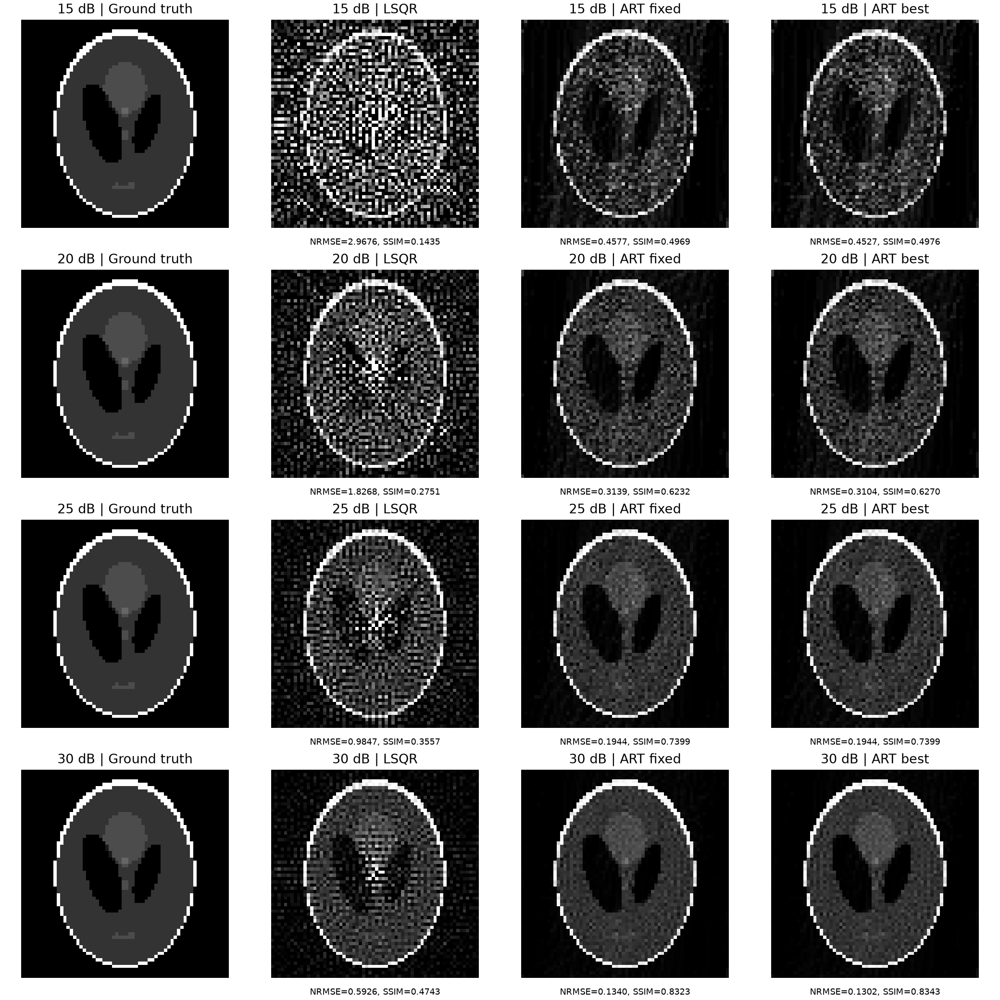

[查看 ART 全轮误差曲线](../outputs/SheppLogan64/figures/SheppLogan64_art_convergence.png)

同一噪声级别下，LS 的投影残差始终低于 ART 第 5 轮，但 NRMSE 均更高。例如 30 dB 时 LS／ART 的残差为 0.0225／0.0378，而 NRMSE 为 0.5926／0.1340。LS 更贴合带噪声观测，却产生大量高频伪影；ART 的早停保留了主要结构。15 dB 时 LS 的像素范围约为 `[-13.75, 14.38]`，真实图像约为 `[0, 1]`，说明 LS 的极端像素值并非图像显示设置造成。

## 3. XCAT128

| 标称 SNR | 实测 SNR | LS NRMSE | LS PSNR | LS SSIM | ART 第 5 轮 NRMSE | ART 第 5 轮 PSNR | ART 第 5 轮 SSIM |
| ---: | ---: | ---: | ---: | ---: | ---: | ---: | ---: |
| 15 dB | 15.007 dB | 121.7020 | -31.43 dB | ≈0.0000 | 0.6874 | 13.53 dB | 0.1881 |
| 20 dB | 19.993 dB | 67.3207 | -26.29 dB | ≈0.0000 | 0.4454 | 17.30 dB | 0.3109 |
| 25 dB | 25.061 dB | 38.7801 | -21.49 dB | 0.0001 | 0.2714 | 21.60 dB | 0.4711 |
| 30 dB | 29.986 dB | 18.1019 | -14.88 dB | 0.0007 | 0.1760 | 25.37 dB | 0.6221 |

| 标称 SNR | LS 相对投影残差 | ART 第 5 轮相对投影残差 | ART 事后最佳轮／NRMSE | ART 第 40 轮 NRMSE | LSQR 迭代次数 |
| ---: | ---: | ---: | ---: | ---: | ---: |
| 15 dB | 0.0677 | 0.2004 | 第 1 轮／0.5638 | 0.8116 | 6261 |
| 20 dB | 0.0376 | 0.1166 | 第 2 轮／0.3885 | 0.6129 | 6343 |
| 25 dB | 0.0222 | 0.0674 | 第 4 轮／0.2646 | 0.4156 | 6040 |
| 30 dB | 0.0124 | 0.0436 | 第 5 轮／0.1760 | 0.2592 | 5629 |

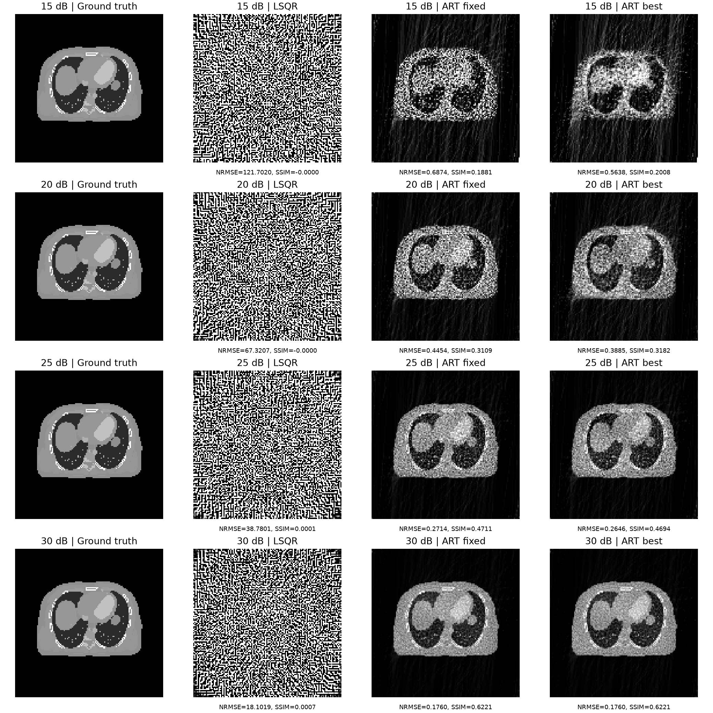

[查看 ART 全轮误差曲线](../outputs/XCAT128/figures/XCAT128_art_convergence.png)

XCAT128 的无正则化 LS 退化尤其明显。15 dB 时，LSQR 的相对投影残差为 0.0677，但 NRMSE 达 121.7020；其像素约在 `[-5.15, 4.80]`，而真实图像范围仅为 `[0, 0.03089]`。这表明带噪声数据中的小误差可被逆问题放大为很大的图像误差。ART 第 5 轮在四档下均保留了可识别的胸部结构，但 15 dB 的最佳轮实际上是第 1 轮，固定第 5 轮已经退化；第 40 轮 NRMSE 进一步升到 0.8116。

## 4. 结论与解释边界

1. **信噪比从 15 dB 升至 30 dB，表示观测噪声变小；两种方法的重建质量整体提高。** 例如 XCAT128 的 ART 第 5 轮 NRMSE 从 0.6874 降至 0.1760。NRMSE 是误差指标，越小越好。
2. **投影拟合好不等于图像重建好。** 两组数据的 LS 均比 ART 第 5 轮具有更低的 `||Ax-b||₂/||b||₂`，但 NRMSE 更高。无正则化 LS 会放大噪声，尤其在 XCAT128 上；加入正则化是后续任务的直接动机。
3. **ART 停止轮数是关键参数。** 噪声较大时应更早停；图中的 `ART best` 是利用已知真实图像事后挑选的上界示例。主要对照采用统一第 5 轮，避免把这种选择当作可直接部署的算法。
4. **方法比较需注意约束不同。** 本实验的 LS 没有非负约束，ART 按 PPT 第 13 页每行施加非负约束，因此两者差异同时包含求解方式、早停和约束的影响；不能仅凭本表断言“ART 算法本身总优于 LS”。

对照图统一使用各数据集真实图像的灰度范围，便于比较结构；超出该范围的 LS 像素在**显示时**被截断，所有指标仍由未经截断的原始重建向量计算。`metrics.csv` 和 `.npy` 文件保留完整数值。下文继续同一常规任务的正则化实验。

## 5. 正则化实验的比较方式

LS+L2、LS+L1、LS+TV 分别求解带对应惩罚项的最小二乘目标。ART+L2、ART+L1、ART+TV 则在每轮 ART 投影后施加图像收缩／TV 处理，固定运行 5 轮。这两类方法的数学目标不同，因此应分别对照原 **LSQR** 和原 **ART 第 5 轮**。每个正则化方法在每个数据条件上从预设网格选 **NRMSE 最低**的参数；该选择使用了已知真实图像，属于事后 *oracle* 调参，结果比真实图像未知时的可用性能更乐观。

下表统一用 NRMSE 比较，**越小越好**。其他完整指标（PSNR、SSIM、相对投影残差）、候选参数和耗时均保存在各数据集的 `selected_metrics.csv`、`candidate_metrics.csv` 中。

### 5.1 SheppLogan64：NRMSE

| SNR | LSQR | LS+L2 | LS+L1 | LS+TV | ART 第 5 轮 | ART+L2 | ART+L1 | ART+TV |
| ---: | ---: | ---: | ---: | ---: | ---: | ---: | ---: | ---: |
| 15 dB | 2.9676 | 0.4576 | 0.4462 | **0.2786** | 0.4577 | 0.4506 | 0.4562 | **0.3790** |
| 20 dB | 1.8268 | 0.3477 | 0.3232 | **0.2056** | 0.3139 | 0.3133 | 0.3136 | **0.2411** |
| 25 dB | 0.9847 | 0.2581 | 0.2179 | **0.1045** | 0.1944 | 0.1944 | 0.1942 | **0.1495** |
| 30 dB | 0.5926 | 0.1898 | 0.1457 | **0.0688** | 0.1340 | 0.1341 | 0.1339 | **0.0943** |

每行粗体分别标出 LS 系列与 ART 系列中误差最低的正则化方法。LS+TV 从 15 dB 的 NRMSE 0.2786 降至 30 dB 的 0.0688；ART+TV 同期从 0.3790 降至 0.0943。30 dB 的 LS+TV 同时达到 PSNR **35.37 dB**、SSIM **0.9339**；原 ART 第 5 轮为 PSNR 29.59 dB、SSIM 0.8323。LS+L2 的优势是大幅抑制原 LS 的噪声放大，但图像细节与背景噪声仍不及本次选择的 TV 参数。

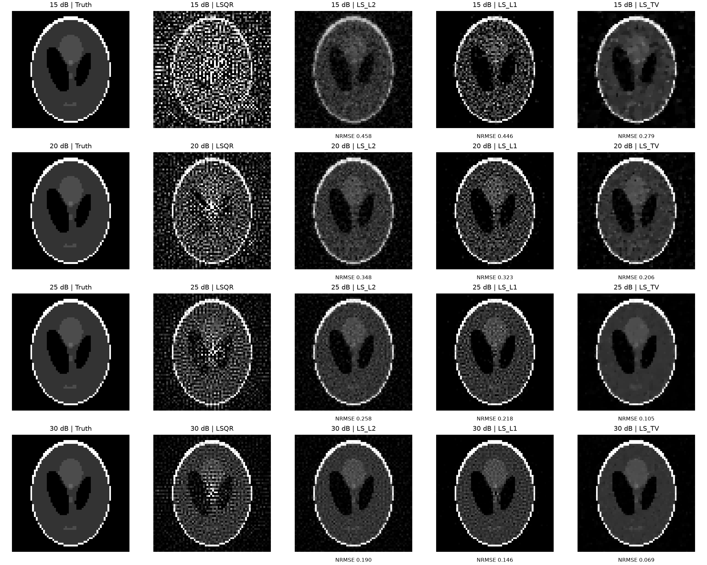

[查看 SheppLogan64 的 ART 正则化对照](../outputs/regularized/SheppLogan64/figures/SheppLogan64_ART_regularization.png)

### 5.2 XCAT128：NRMSE

| SNR | LSQR | LS+L2 | LS+L1 | LS+TV | ART 第 5 轮 | ART+L2 | ART+L1 | ART+TV |
| ---: | ---: | ---: | ---: | ---: | ---: | ---: | ---: | ---: |
| 15 dB | 121.7020 | 0.3638 | 0.8665 | **0.2269** | 0.6874 | 0.5856 | 0.6849 | **0.3795** |
| 20 dB | 67.3207 | 0.2949 | 0.6902 | **0.1765** | 0.4454 | 0.4155 | 0.4448 | **0.2652** |
| 25 dB | 38.7801 | 0.2338 | 0.5293 | **0.1411** | 0.2714 | 0.2685 | 0.2714 | **0.1871** |
| 30 dB | 18.1019 | 0.1957 | 0.4177 | **0.1066** | 0.1760 | 0.1760 | 0.1759 | **0.1355** |

XCAT128 的无正则化 LS 特别不稳定；L2 已将 15 dB 的 NRMSE 从 121.7020 降至 0.3638，TV 进一步降至 0.2269。30 dB 的 LS+TV 达到 PSNR **29.72 dB**、SSIM **0.8237**，而原 ART 第 5 轮为 25.37 dB、0.6221。ART+TV 也在四档下均降低了对应 ART 第 5 轮的 NRMSE，15 dB 从 0.6874 降至 0.3795。

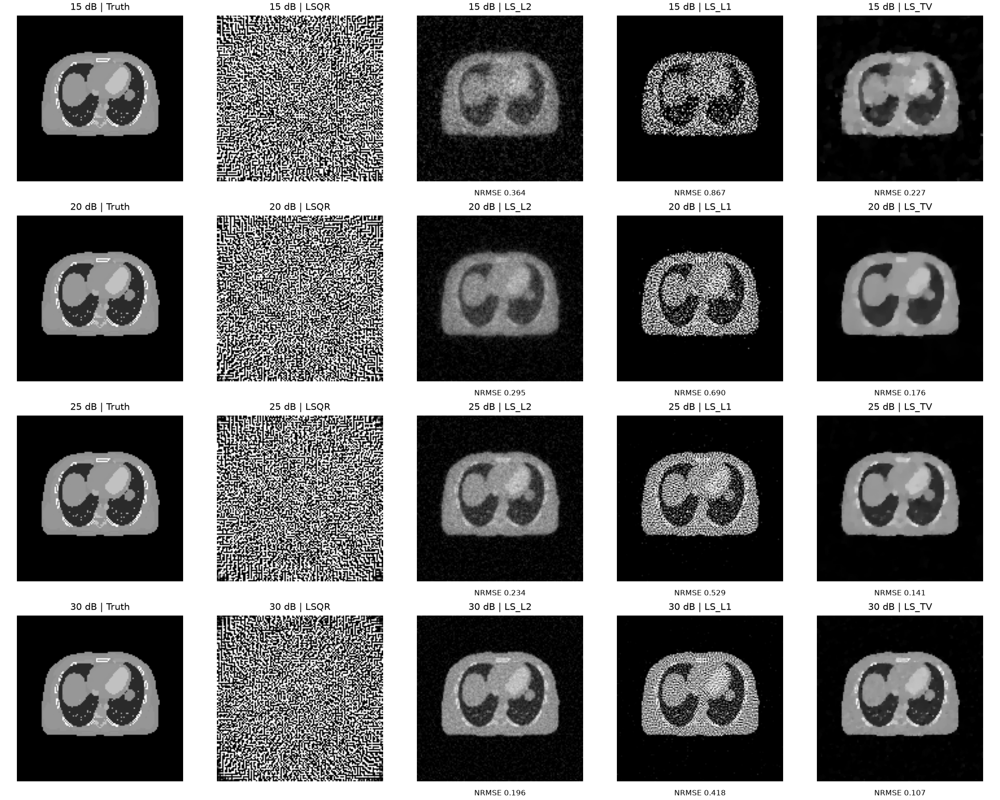

[查看 XCAT128 的 ART 正则化对照](../outputs/regularized/XCAT128/figures/XCAT128_ART_regularization.png)

## 6. 选中参数与指标解释

下表的 `p` 是无量纲网格值。**LS+L2 列直接是 λ**；LS+L1／TV 的实际 `λ=p·L·data_range`；ART+L2 列是每轮收缩强度 `α`；ART+L1／TV 的实际近端强度为 `α=p·data_range`。参数定义不同，数值不能直接相互比较。

| 数据集 | SNR | LS+L2 λ | LS+L1 p | LS+TV p | ART+L2 α | ART+L1 p | ART+TV p |
| --- | ---: | ---: | ---: | ---: | ---: | ---: | ---: |
| SheppLogan64 | 15 dB | 100 | 0.01 | 0.001 | 0.1 | 0.01 | 0.03 |
| SheppLogan64 | 20 dB | 30 | 0.003 | 0.0003 | 0.01 | 0.003 | 0.03 |
| SheppLogan64 | 25 dB | 10 | 0.003 | 0.0003 | 0.001 | 0.003 | 0.01 |
| SheppLogan64 | 30 dB | 3 | 0.001 | 0.0001 | 0.001 | 0.001 | 0.01 |
| XCAT128 | 15 dB | 300 | 0.03 | 0.003 | 0.3 | 0.03 | 0.2 |
| XCAT128 | 20 dB | 300 | 0.01 | 0.003 | 0.1 | 0.01 | 0.1 |
| XCAT128 | 25 dB | 100 | 0.003 | 0.001 | 0.03 | 0.001 | 0.03 |
| XCAT128 | 30 dB | 30 | 0.001 | 0.0003 | 0.001 | 0.003 | 0.03 |

这两组数据中，高噪声通常需要更强的正则化。以 XCAT128 的 LS+TV 为例，选中 `p` 从 15 dB 的 0.003 降到 30 dB 的 0.0003。TV 对相邻像素差分施加约束，使大片均匀区域更平滑，同时比单纯 L2 更能保留结构边缘；对照图与 NRMSE 一起支持本次数据上的这一判断。L1 惩罚的是**像素值本身**；XCAT128 的有效组织区域包含大量非零像素，这可能是像素 L1 在本实验中 NRMSE 较高的原因之一，仍需进一步消融才能确认。不过不同指标会给出不同排序：XCAT128 15 dB 的 LS+L1 SSIM 为 **0.6819**，高于 LS+TV 的 **0.5219**，但其 NRMSE 0.8665 高于 TV 的 0.2269。报告采用 NRMSE 选参数，不能把“TV 在 NRMSE 上最优”扩展成“所有指标上都最优”。

## 7. 结果边界与后续复现

- 参数搜索利用了真实图像，且在同一批图像上报告成绩；因此这些选中结果用于理解不同正则化的作用，不能当作未知真实图像时的无偏性能估计。`candidate_metrics.csv` 保留每个候选，可检查是否落在网格边界，也可改用其他选择规则重新分析。
- LS+L1 固定运行 1200 次、LS+TV 固定运行 600 次 FISTA，未声明严格收敛。LS+L2 的候选均满足 LSQR 数值停止准则。ART 正则化是每轮投影后的近端图像处理，**不等同于**精确求解相应的 LS 惩罚目标。
- 正则化图与基线图使用各数据集真实图像的相同灰度范围；指标始终从未裁剪的 `.npy` 重建向量计算。第 17 页的扩展实验单独记录于第 8 节起。

完整复现命令及代码定位见 [实验实施记录](实验实施记录.md)。

## 8. 稀疏角度传统方法扩展

本节比较两组图像在90、45、30、15个投影角度，以及15、20、25、30 dB标注信噪比下的重建。方法为LSQR、固定5轮ART、LS+L2、LS+TV、每轮加入TV处理的ART+TV。共32个数据条件、160个选中结果，最终公共网格共保存864个候选。NRMSE越小越好；表中每行最小NRMSE加粗。

正则化参数均在预设网格中按真实图像GT的NRMSE事后选择，属于**oracle结果**，不能代表未知真实图像时自动选参的性能。TV和ART+TV网格还使用GT灰度范围校准强度；GT未进入求解器的数据拟合项。ART+TV是每轮ART后施加TV近端处理并保持非负，不等同于精确求解LS+TV目标。所有图像指标对未裁剪的重建向量计算，图中统一使用GT灰度范围显示。

### 8.1 采样方式与几何尺寸

原90个角度为0、2、…、178°。保留90/45/30/15角时分别每隔1/2/3/6个原角度选取一次，选择一个角度对应的完整连续探测器行块，同时对A与b使用相同索引；未重新生成噪声，也未删除所选角度中的零行。图像展开与还原均采用列优先F顺序。

| 角度数 | SheppLogan64矩阵尺寸 | 有效非零行 | XCAT128矩阵尺寸 | 有效非零行 |
|---:|---:|---:|---:|---:|
| 90 | 8190×4096 | 7352 | 16290×16384 | 14680 |
| 45 | 4095×4096 | 3676 | 8145×16384 | 7340 |
| 30 | 2730×4096 | 2444 | 5430×16384 | 4884 |
| 15 | 1365×4096 | 1222 | 2715×16384 | 2442 |

SheppLogan64在45角及以下满足方程总数小于未知数；XCAT128在90角时已经满足这一维数上的欠定条件。非零行数也不等于矩阵秩。本实验模拟减少投影角度的采样条件，未模拟真实扫描的光子计数或剂量变化，因而不能报告实际辐射剂量降低比例。

取子集后实际SNR略有变化：

| 文件标注SNR | 32个条件中的实际SNR范围（dB） |
|---:|---:|
| 15 | 14.8920–15.0862 |
| 20 | 19.9628–20.0930 |
| 25 | 24.9583–25.1472 |
| 30 | 29.8209–29.9981 |

### 8.2 全部条件的NRMSE

**SheppLogan64**

| 角度数 | SNR（dB） | LSQR | ART（5轮） | LS+L2 | LS+TV | ART+TV |
|---:|---:|---:|---:|---:|---:|---:|
| 90 | 15 | 2.9638 | 0.4577 | 0.4493 | **0.2786** | 0.3790 |
| 90 | 20 | 1.8250 | 0.3139 | 0.3468 | **0.2056** | 0.2411 |
| 90 | 25 | 0.9857 | 0.1944 | 0.2588 | **0.1045** | 0.1495 |
| 90 | 30 | 0.5933 | 0.1340 | 0.1914 | **0.0688** | 0.0943 |
| 45 | 15 | 47.3510 | 0.4969 | 0.5112 | **0.3867** | 0.3925 |
| 45 | 20 | 53.3545 | 0.3483 | 0.4270 | **0.2593** | 0.2774 |
| 45 | 25 | 22.3548 | 0.2396 | 0.3642 | **0.1579** | 0.1917 |
| 45 | 30 | 14.0495 | 0.1946 | 0.3219 | **0.1053** | 0.1524 |
| 30 | 15 | 52.2013 | 0.5100 | 0.5411 | 0.4275 | **0.4112** |
| 30 | 20 | 13.4094 | 0.3585 | 0.4685 | 0.3181 | **0.3047** |
| 30 | 25 | 10.0186 | 0.2847 | 0.4155 | **0.2002** | 0.2436 |
| 30 | 30 | 6.1513 | 0.2526 | 0.3895 | **0.1381** | 0.2204 |
| 15 | 15 | 8.4228 | 0.5578 | 0.6239 | 0.5247 | **0.4982** |
| 15 | 20 | 5.3150 | 0.4497 | 0.5695 | 0.4440 | **0.4263** |
| 15 | 25 | 2.5519 | 0.3987 | 0.5427 | **0.3656** | 0.3807 |
| 15 | 30 | 1.4381 | 0.3857 | 0.5320 | **0.2912** | 0.3698 |

**XCAT128**

| 角度数 | SNR（dB） | LSQR | ART（5轮） | LS+L2 | LS+TV | ART+TV |
|---:|---:|---:|---:|---:|---:|---:|
| 90 | 15 | 122.2795 | 0.6874 | 0.3607 | **0.2269** | 0.3795 |
| 90 | 20 | 66.7305 | 0.4454 | 0.2925 | **0.1765** | 0.2652 |
| 90 | 25 | 38.7316 | 0.2714 | 0.2402 | **0.1411** | 0.1871 |
| 90 | 30 | 18.3590 | 0.1760 | 0.1899 | **0.1066** | 0.1355 |
| 45 | 15 | 37.4210 | 0.6400 | 0.3870 | **0.2476** | 0.3435 |
| 45 | 20 | 21.7773 | 0.4084 | 0.3258 | **0.1989** | 0.2550 |
| 45 | 25 | 13.0615 | 0.2574 | 0.2636 | **0.1665** | 0.1943 |
| 45 | 30 | 8.5236 | 0.1848 | 0.2239 | **0.1390** | 0.1533 |
| 30 | 15 | 11.2511 | 0.5881 | 0.4056 | **0.2613** | 0.3321 |
| 30 | 20 | 8.1458 | 0.3673 | 0.3394 | **0.2125** | 0.2390 |
| 30 | 25 | 3.6319 | 0.2427 | 0.2798 | **0.1796** | 0.1878 |
| 30 | 30 | 2.4579 | 0.1928 | 0.2481 | **0.1478** | 0.1665 |
| 15 | 15 | 5.7522 | 0.5365 | 0.4388 | **0.3089** | 0.3513 |
| 15 | 20 | 5.8378 | 0.3562 | 0.3770 | **0.2455** | 0.2685 |
| 15 | 25 | 2.3794 | 0.2659 | 0.3317 | **0.2082** | 0.2309 |
| 15 | 30 | 1.5625 | 0.2352 | 0.3122 | **0.1885** | 0.2154 |

LS+TV在32个条件中的28个取得五种方法中最小NRMSE。ART+TV胜出的4个条件全部来自SheppLogan64：

| 角度数 | SNR（dB） | ART+TV NRMSE | LS+TV NRMSE |
|---:|---:|---:|---:|
| 30 | 15 | 0.4112 | 0.4275 |
| 30 | 20 | 0.3047 | 0.3181 |
| 15 | 15 | 0.4982 | 0.5247 |
| 15 | 20 | 0.4263 | 0.4440 |

### 8.3 30 dB下的SSIM及图像差别

| 数据集 | 角度数 | ART（5轮）SSIM | LS+TV SSIM | ART+TV SSIM |
|---|---:|---:|---:|---:|
| SheppLogan64 | 90 | 0.8323 | 0.9339 | 0.9088 |
| SheppLogan64 | 45 | 0.7904 | 0.8810 | 0.8703 |
| SheppLogan64 | 30 | 0.7593 | 0.9179 | 0.8317 |
| SheppLogan64 | 15 | 0.6457 | 0.7669 | 0.7106 |
| XCAT128 | 90 | 0.6221 | 0.8237 | 0.6596 |
| XCAT128 | 45 | 0.6844 | 0.8874 | 0.6802 |
| XCAT128 | 30 | 0.7148 | 0.8432 | 0.6948 |
| XCAT128 | 15 | 0.6765 | 0.7146 | 0.6703 |

在30 dB下，LS+TV的NRMSE随角度从90减少到15而增大：SheppLogan64为0.0688→0.2912，XCAT128为0.1066→0.1885；比较图可见少角度时结构模糊和细节损失。SSIM并非同步单调变化，例如XCAT128的LS+TV在45角时SSIM为0.8874，高于90角的0.8237，尽管NRMSE更差。

正则化也不保证所有指标同时改善。例如XCAT128、30角、30 dB时，ART加入TV后NRMSE从0.1928降至0.1665，但SSIM从0.7148降至0.6948。应结合细小结构和边缘观察，而不能仅凭一项指标宣布全面改善。

### 8.4 非单调结果与解释边界

**减少角度不一定使某个既定算法的NRMSE变差。** XCAT128在15 dB下，90→45→30→15角的LSQR NRMSE为122.2795→37.4210→11.2511→5.7522，ART固定5轮为0.6874→0.6400→0.5881→0.5365。这些结果描述的是本次噪声和求解协议：LSQR无正则化时存在明显噪声放大，角度选择还改变系统的约束与迭代终止过程；固定5轮ART在少角度时处理的总行更新次数更少。因此不能由这些数值推出“更少观测本质上更准确”。本实验没有把这些因素分别消融。

**提高标注SNR也未使LSQR每个条件严格单调改善。** 例如SheppLogan64、45角时，15→20 dB的LSQR NRMSE从47.3510增至53.3545；XCAT128、15角时从5.7522增至5.8378。四份观测包含不同噪声实现，本实验仅对每种给定观测运行一次，且求解器按数值容差停止；这些条件不足以保证逐点单调。TV的30 dB角度退化趋势及完整表格应分别报告。

### 8.5 网格补测、求解状态与验证

初次LS+TV网格为7个近端权重比例，4个XCAT条件（45角/15 dB、30角/15 dB、15角/15 dB、15角/20 dB）的最优值落在上边界0.01。随后对全部32条件统一补测0.03、0.1两项，将公共网格扩至9值，追加64个候选。补测未改变选中结果，最终96个正则化选择全部位于各自网格内部；这说明已检查原边界外两个更大强度，不等于连续参数的全局最优证明。原网格配置与运行记录分别保存在`configuration_initial_grid.json`、`run_status_initial_grid.json`。

LS+L2采用归一化参数λ=0.0001、0.0003、0.001、0.003、0.01、0.03、0.1、0.3，求解器使用原始惩罚系数mλ；LS+TV同样记录原始与按观测行数m归一化的λ，m保留零行。完整参数、残差和时间见最终`selected_metrics.csv`、`candidate_metrics.csv`。

32个LSQR与32个LS+L2均以停止码2终止：该停止码表示满足近似最小二乘的数值终止条件，并不表示图像重建准确。LSQR实际迭代631–6372次（上限10000），L2为17–100次（上限5000），均未触发迭代上限。ART与ART+TV固定5轮。32个选中LS+TV均使用固定600次FISTA预算，未采用收敛判定；近端TV内部上限80次、eps=1e-4。

选中TV结果从第550到600次的目标函数相对变动绝对值介于5.77e-10与4.29e-04，最大约0.04294%，出现在XCAT128、30角、20 dB。该末段变化支持本次固定预算下的数值稳定性，但不是严格收敛证书。初网格墙时269.38秒，补网格与重新出图191.54秒，两次合计460.92秒；全部864个候选累计求解器时间423.43秒。

本节90角结果也用当前扩展配置重新计算，复用的只有稀疏矩阵缓存；未将旧实验结果混入表格。旧实验的参数网格与本节不同，部分LSQR数值也不完全相同：例如XCAT128、90角、30 dB，旧记录NRMSE为18.1019，本次为18.3590；其迭代次数分别为5629和5798。这一差异的数值来源未逐项定位，故角度对照统一采用本节重新计算的90角结果。

执行`& '.\.conda\python.exe' -m unittest test_sparse_views -v`，4项测试全部通过：检查完整角度块及b同步选择、全角度恒等与错误输入、F顺序还原，并逐一重算全部160个选中向量的指标、核对对应网格最小NRMSE和L2系数换算。计算指标与记录一致至小数点后11位。断点续跑还检查数据与求解代码指纹，避免数据或代码改变后复用旧候选。

### 8.6 结果图

**SheppLogan64：角度数与NRMSE**

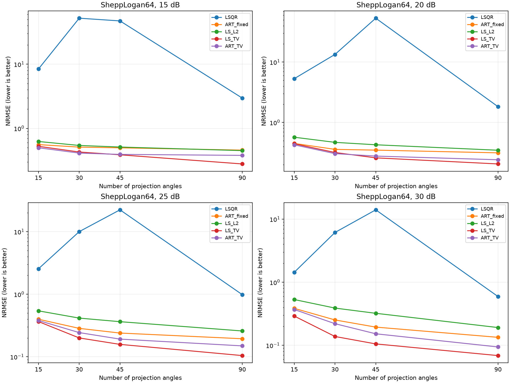

**SheppLogan64：角度数与SSIM**

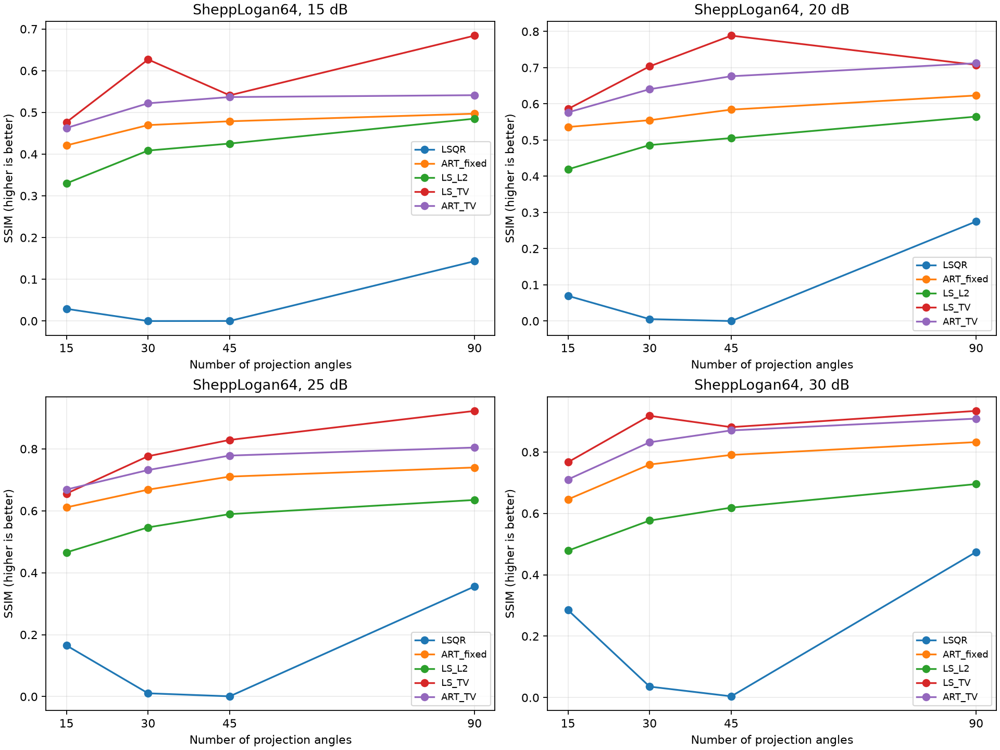

**SheppLogan64：30 dB、统一灰度范围的重建对比**

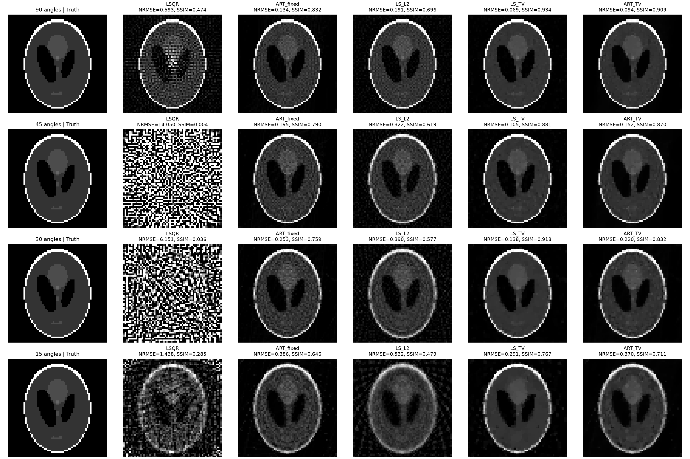

**XCAT128：角度数与NRMSE**

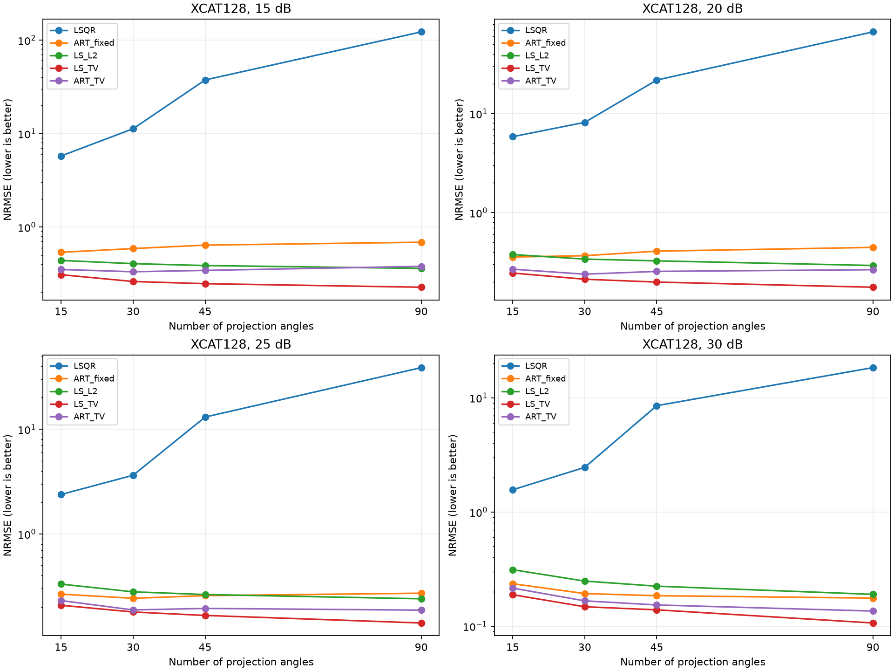

**XCAT128：角度数与SSIM**

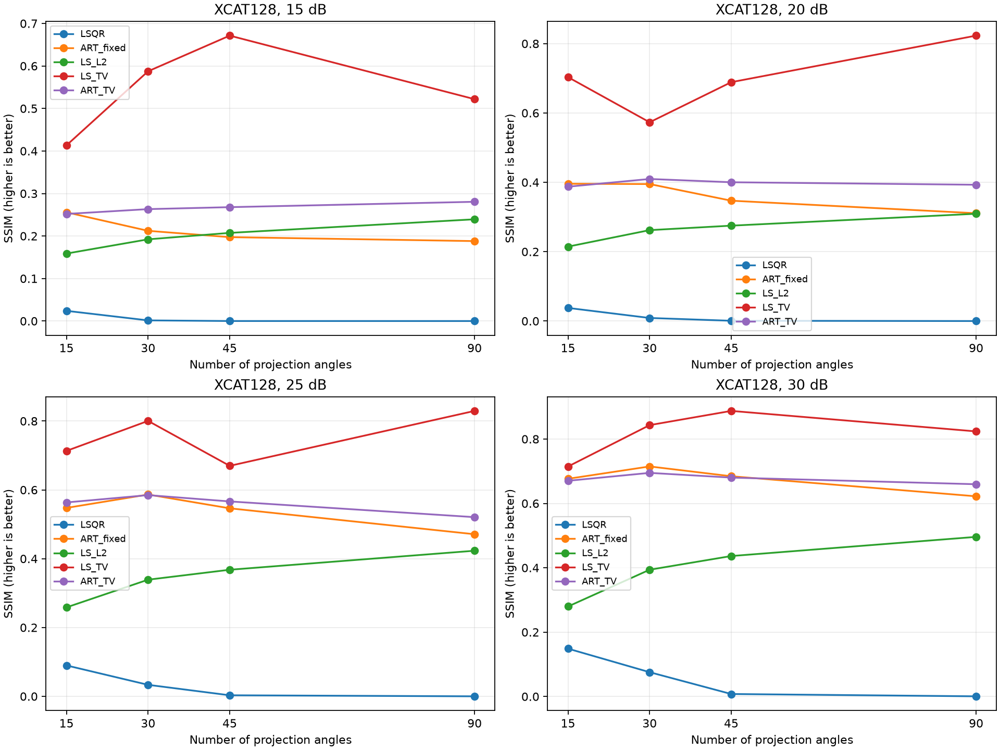

**XCAT128：30 dB、统一灰度范围的重建对比**

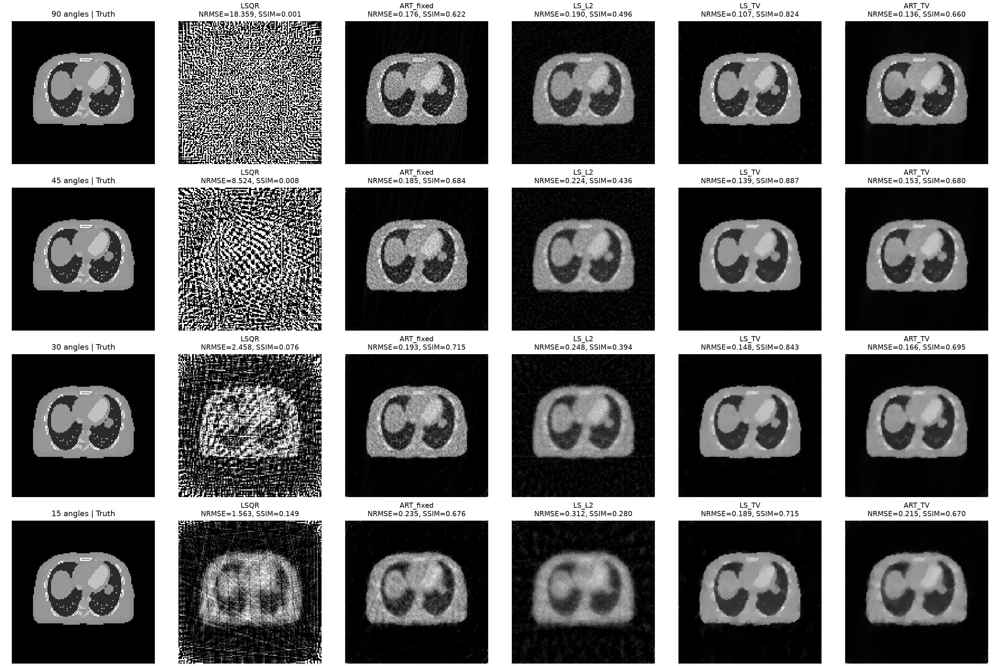

## 9. DIP 与 DIP+TV 扩展结果

两数据集、30／15 角、20／30 dB、两个网络方法、三个随机种子，共完成 48 次 2000 步拟合。主结果为固定终点；另外报告每 50 步采样的 GT oracle 截点。下表的 ± 为三个种子的**样本标准差**，不是置信区间。传统 TV 参数按 GT NRMSE 选择，而 DIP+TV 的 β 预先固定为 20 dB 下 0.01、30 dB 下 0.001；两类选参规则和可行域不同，应结合这些设置理解对照。

### 9.1 固定第 2000 步的 NRMSE

| 数据集 | 角度数 | SNR | LS+TV（oracle参数） | ART+TV（oracle参数） | DIP（均值±std） | DIP+TV（均值±std） | DIP+TV相对LS+TV的NRMSE降低 |
| --- | ---: | ---: | ---: | ---: | ---: | ---: | ---: |
| SheppLogan64 | 30 | 20 dB | 0.3181 | 0.3047 | 0.5808 ± 0.0199 | 0.3077 ± 0.0012 | +3.3% |
| SheppLogan64 | 30 | 30 dB | 0.1381 | 0.2204 | 0.1815 ± 0.0116 | 0.1029 ± 0.0007 | +25.5% |
| SheppLogan64 | 15 | 20 dB | 0.4440 | 0.4263 | 0.6087 ± 0.1276 | 0.3905 ± 0.0068 | +12.0% |
| SheppLogan64 | 15 | 30 dB | 0.2912 | 0.3698 | 0.4353 ± 0.2595 | 0.1897 ± 0.0017 | +34.9% |
| XCAT128 | 30 | 20 dB | 0.2125 | 0.2390 | 0.4601 ± 0.2239 | 0.2369 ± 0.0522 | -11.5% |
| XCAT128 | 30 | 30 dB | 0.1478 | 0.1665 | 0.2539 ± 0.0146 | 0.1594 ± 0.0043 | -7.8% |
| XCAT128 | 15 | 20 dB | 0.2455 | 0.2685 | 0.6341 ± 0.1755 | 0.2604 ± 0.0018 | -6.1% |
| XCAT128 | 15 | 30 dB | 0.1885 | 0.2154 | 0.3041 ± 0.0021 | 0.1980 ± 0.0049 | -5.0% |

最后一列为 `(LS_TV NRMSE − DIP_TV平均NRMSE)/LS_TV NRMSE`；负值表示 DIP+TV 误差更高。表格没有按最佳种子选取成绩。

### 9.2 同一终点的 SSIM

| 数据集 | 角度数 | SNR | LS+TV | ART+TV | DIP（均值±std） | DIP+TV（均值±std） |
| --- | ---: | ---: | ---: | ---: | ---: | ---: |
| SheppLogan64 | 30 | 20 dB | 0.7037 | 0.6405 | 0.5484 ± 0.0129 | 0.8163 ± 0.0017 |
| SheppLogan64 | 30 | 30 dB | 0.9179 | 0.8317 | 0.8176 ± 0.0126 | 0.9354 ± 0.0014 |
| SheppLogan64 | 15 | 20 dB | 0.5859 | 0.5765 | 0.5595 ± 0.0729 | 0.7495 ± 0.0176 |
| SheppLogan64 | 15 | 30 dB | 0.7669 | 0.7106 | 0.6065 ± 0.2514 | 0.8834 ± 0.0058 |
| XCAT128 | 30 | 20 dB | 0.5732 | 0.4097 | 0.6211 ± 0.1332 | 0.7486 ± 0.0771 |
| XCAT128 | 30 | 30 dB | 0.8432 | 0.6948 | 0.8090 ± 0.0051 | 0.8689 ± 0.0052 |
| XCAT128 | 15 | 20 dB | 0.7034 | 0.3874 | 0.5191 ± 0.0577 | 0.7266 ± 0.0041 |
| XCAT128 | 15 | 30 dB | 0.7146 | 0.6703 | 0.7568 ± 0.0024 | 0.8269 ± 0.0046 |

PSNR、相对投影残差、每个种子的结果及耗时均保存在 `outputs/extension/dip/individual_metrics.csv` 和 `aggregate_metrics.csv`。PSNR 的汇总是各次 PSNR 的均值，不是把平均 MSE 再转换成 PSNR。

### 9.3 真值辅助的 oracle 截点诊断

本表的 GT 最小 NRMSE 截点不能直接用于未知真实图像的自动早停；它与同一次固定预算轨迹对应，并非另一次训练。步数范围为三个种子的最优采样截点最小／最大值。

| 数据集 | 角度数 | SNR | DIP oracle NRMSE | DIP截点范围 | DIP+TV oracle NRMSE | DIP+TV截点范围 |
| --- | ---: | ---: | ---: | ---: | ---: | ---: |
| SheppLogan64 | 30 | 20 dB | 0.2952 ± 0.0100 | 300–350 | 0.3021 ± 0.0006 | 750–800 |
| SheppLogan64 | 30 | 30 dB | 0.1488 ± 0.0049 | 750–850 | 0.1027 ± 0.0007 | 1950–2000 |
| SheppLogan64 | 15 | 20 dB | 0.3962 ± 0.0078 | 200–250 | 0.3802 ± 0.0022 | 500–1950 |
| SheppLogan64 | 15 | 30 dB | 0.2513 ± 0.0105 | 750–850 | 0.1888 ± 0.0002 | 1300–2000 |
| XCAT128 | 30 | 20 dB | 0.2521 ± 0.0026 | 250–300 | 0.2027 ± 0.0015 | 1150–1200 |
| XCAT128 | 30 | 30 dB | 0.1910 ± 0.0034 | 700–750 | 0.1583 ± 0.0055 | 1950–2000 |
| XCAT128 | 15 | 20 dB | 0.2860 ± 0.0054 | 150–200 | 0.2419 ± 0.0012 | 550–700 |
| XCAT128 | 15 | 30 dB | 0.2325 ± 0.0058 | 400–600 | 0.1979 ± 0.0050 | 1950–2000 |

48 次拟合的累计训练与评价计时为 **818.09 秒**，单次 15.62–17.92 秒，不含网络初始化、矩阵构造与保存绘图；全部使用 RTX 5070。DIP 的 24 次训练中 0 次最优采样截点在预算终点，DIP+TV 为 6 次。落在终点的记录说明当前预算内尚未观察到更优的早期截点，不能证明继续训练一定改善，也不能宣称网络优化已严格收敛。

### 9.4 共同条件对照图

柱状图使用全部三种子的均值及样本标准差；图像示例预先固定展示 seed 0，不选最优种子。所有显示图共用本数据集的 GT 灰度范围，指标使用原始向量。

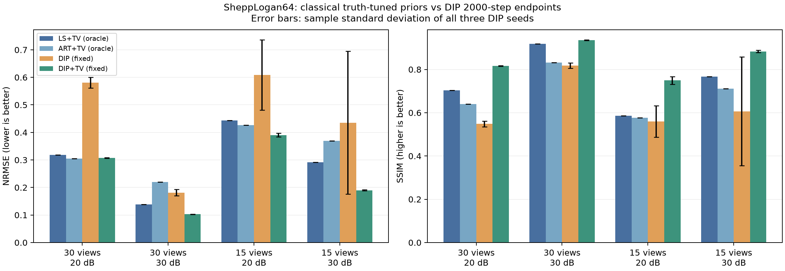

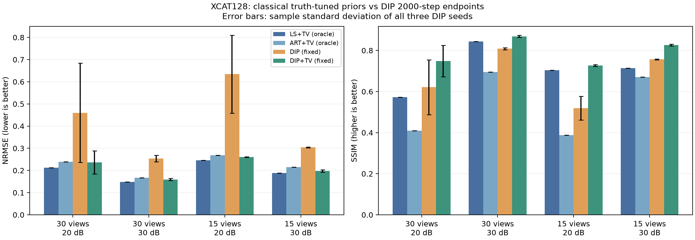

[SheppLogan64全部共同条件图像](../outputs/extension/summary/SheppLogan64_shared_cases.png)；[XCAT128全部共同条件图像](../outputs/extension/summary/XCAT128_shared_cases.png)。

[SheppLogan64三种子误差轨迹](../outputs/extension/dip/figures/SheppLogan64_DIP_history.png)；[XCAT128三种子误差轨迹](../outputs/extension/dip/figures/XCAT128_DIP_history.png)。

### 9.5 本次结果支持的结论

**给 DIP 加 TV 后，八个条件的平均 NRMSE 均低于普通 DIP，平均 SSIM 均更高。** TV 约束在本次固定 2000 步协议下改善了终点重建；多数条件的种子间波动也减小，但并非全部。例如 XCAT、15 角、30 dB 的 NRMSE 标准差从 DIP 的 0.0021 增至 DIP+TV 的 0.0049。不能把三种子的观察扩展为任意初始化上的保证。

**与传统 TV 比较，结果依赖数据集与评价指标。** SheppLogan 的四个共同条件中，DIP+TV 的平均 NRMSE 都低于 LS+TV，其中 15 角、30 dB 从 0.2912 降至 0.1897±0.0017，相对降低 34.9%，SSIM 从 0.7669 提高至 0.8834±0.0058。不过 30 角、20 dB 下 ART+TV 的 0.3047 仍低于 DIP+TV 的 0.3077，不能说网络胜过全部传统方法。

XCAT 的四个共同条件中，LS+TV 的 NRMSE 都低于 DIP+TV 的三种子均值，后者误差高 5.0%–11.5%；DIP+TV 的平均 SSIM 却都更高。例如 15 角、30 dB，LS+TV 与 DIP+TV 的 NRMSE 为 0.1885 和 0.1980±0.0049，而 SSIM 为 0.7146 和 0.8269±0.0046。两项指标衡量的图像差别不同，且参数选择规则与非负约束不同，这组对照不足以证明某方法全面优越。图像仍存在模糊、纹理噪声与小结构丢失，不能只根据较高 SSIM 判断所有细节恢复准确。

**固定迭代数与最佳图像截点存在差距，而且退化原因不能一概而论。** SheppLogan、30 角、20 dB、DIP seed 0 的 NRMSE 从第 300 步的 0.2954 增至终点 0.5940，而相对投影残差从 0.0902 降至 0.0695：更贴合带噪 b 的图像反而更差，与噪声过拟合现象一致。另一条件 SheppLogan、15 角、30 dB、DIP seed 1 的残差却从第 750 步的 0.0241 增至终点 0.2174，图像误差也增大，说明还存在观测拟合退化／优化波动，不能把所有终点退化都归因于拟合噪声。当前非凸网络优化没有严格收敛保证，也没有定位每次波动的具体数值原因。

DIP+TV 减轻了这些问题，但仍有例外：XCAT、30 角、20 dB、seed 1 的 oracle NRMSE 为 0.2040、终点为 0.2972，导致该条件固定终点标准差达到 0.0522。该次运行仍保留在正式统计中。oracle 表说明早停有改进潜力，但本次没有实现未知 GT 的自动截点选择；可在后续使用独立投影验证集或噪声差异原则研究这一点。

## 10. 完成情况与结果核验

- 常规任务的基线与正则化结果保留；扩展实际完成 864 个传统候选、160 个选中重建，以及 48 次神经网络拟合的 96 个 fixed／oracle 截点。
- 项目 Conda 环境完成 CUDA PyTorch 安装，全部 13 项测试通过。独立产物审计为 `passed`，7953 个断言，错误与缺失列表均为空；逐一重算了 256 个正式选中／截点向量的四项指标。
- 恢复两个数据集各一个保存模型，GPU 输出与保存向量完全一致；保存向量、CSV、JSON、轨迹、参数、初始化哈希和图像可互相核对。其余模型没有逐个恢复测试。
- 初次无归一化网络的退化结果及试运行单独保留，不纳入本节正式统计。传统权重用 GT 校准并选择，DIP oracle 截点用 GT 诊断；主要网络结果为无需 GT 选择的固定终点。本次适配实现不是原论文指标复现，也未完成监督模型训练、未知 GT 自动早停或真实辐射剂量评估。

验证文件为 [`outputs/extension/audit_summary.json`](../outputs/extension/audit_summary.json)；复现与继续修改见 [实验实施记录第 8–10 节](实验实施记录.md)。

## 11. 发布版本说明（2026-10-03）

GitHub 发布只适配无损压缩数据读取，不改变上述正式重建数组或指标。新增数据读取回归测试后，共 14 项测试通过；此前 13 项测试是原实验完成时的记录。压缩矩阵的 CSR 索引与 float64 数值已逐项确认与实验使用矩阵完全相等。下载／复核方法见 [GitHub发布与复现说明](GitHub发布与复现说明.md)。
