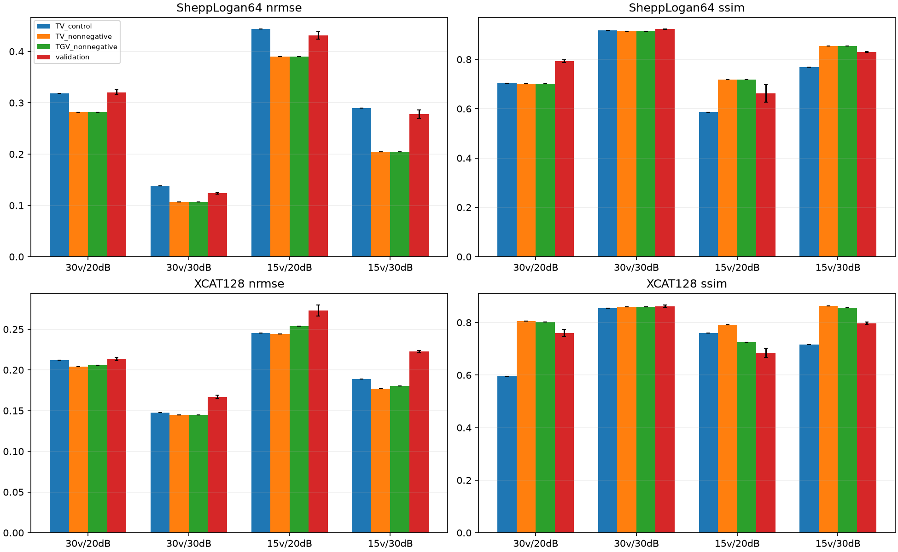
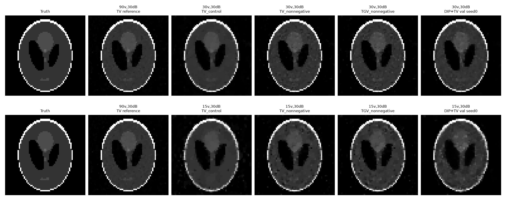
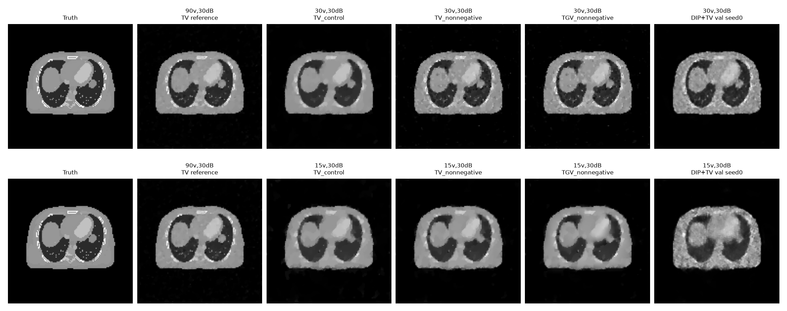
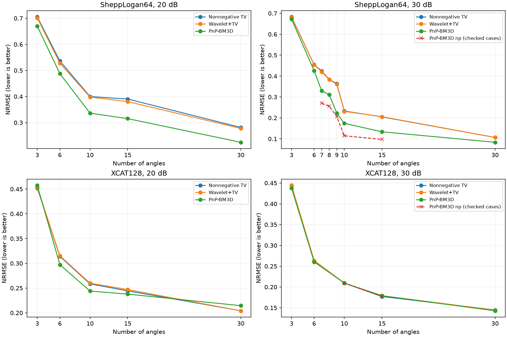
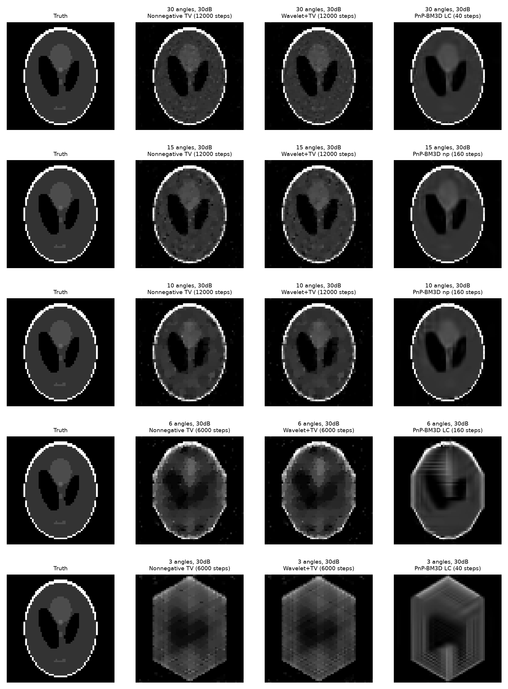
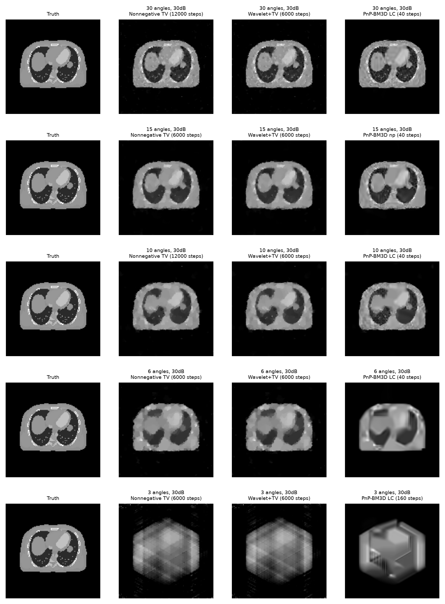
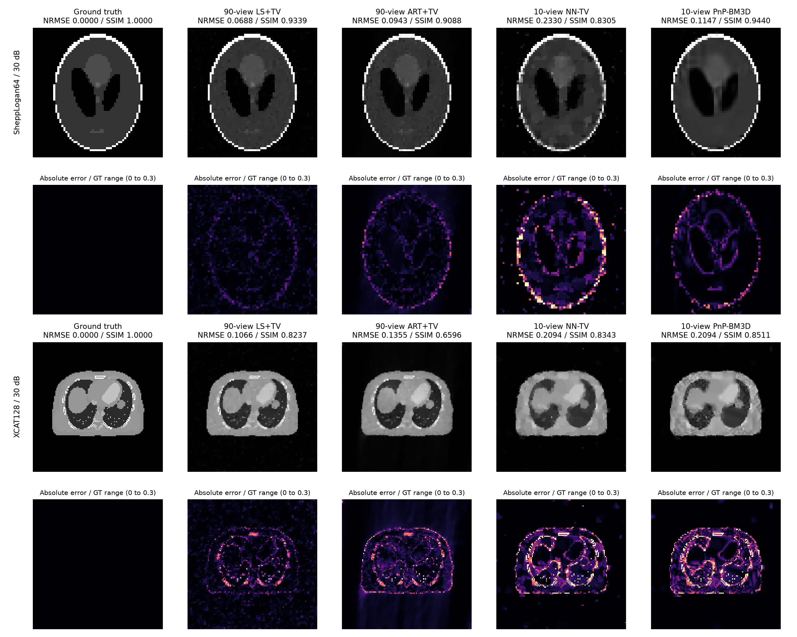

# Project 1：基线、正则化与扩展重建实验结果

作业交付版已整理为[正式实验报告](../report/CT图像重建与稀疏角度优化实验报告修订版.docx)，并提供[Markdown源稿](../report/CT图像重建与稀疏角度优化实验报告修订版.md)。本文件保留各阶段的完整结果与更正记录；正式报告统一主线、原90角参照和论文引用。

**2026-10-10 对照目标更正：用户要求以原90角 LS+TV／ART+TV 为质量参照。第13节的“历史15角门槛”保留为历史分析，不代表已经达到用户目标；正确对照、实验设置差异及高SSIM解释见第14节。**

常规实验日期：2026-09-28；扩展实验日期：2026-10-02。第 1–4 节保留 LSQR／ART 基线，第 5–7 节记录 L2／L1／TV 正则化；第 8 节起记录稀疏角度与 DIP 扩展。详细环境、算法和复现命令见《实验实施记录.md》；扩展逐项数值保存于 `outputs/extension/classical/` 和 `outputs/extension/dip/`，各阶段的表格采用各自实际运行产物。

## 1. 数据与评价约定

输入标称信噪比为 15、20、25、30 dB。表中“实测 SNR”由 `A @ gt` 与给定 `b_hat` 计算，核对了数据文件标签。NRMSE 越小、PSNR 和 SSIM 越大，通常说明重建更接近真实图像。PSNR 的 `data_range` 分别取各自真实图像的最大值减最小值；因此重点比较**同一数据集内**的方法和噪声级别。

ART 采用 `x=0` 初始化、按固定行顺序更新、松弛因子 1、每行后截断负值、共 40 轮。下表 ART 指标均取固定第 5 轮，不根据真实图像选停止点。LSQR 设置 `atol=btol=1e-5`、迭代上限 10,000；8 次运行的停止码均为 2，表示满足其近似最小二乘停止准则。

## 2. SheppLogan64

| 标称 SNR | 实测 SNR | LS NRMSE | LS PSNR | LS SSIM | ART 第 5 轮 NRMSE | ART 第 5 轮 PSNR | ART 第 5 轮 SSIM |
| ---: | ---: | ---: | ---: | ---: | ---: | ---: | ---: |
| 15 dB | 14.985 dB | 2.9676 | 2.68 dB | 0.1435 | 0.4577 | 18.91 dB | 0.4969 |
| 20 dB | 20.031 dB | 1.8268 | 6.89 dB | 0.2751 | 0.3139 | 22.19 dB | 0.6232 |
| 25 dB | 24.958 dB | 0.9847 | 12.26 dB | 0.3557 | 0.1944 | 26.35 dB | 0.7399 |
| 30 dB | 29.922 dB | 0.5926 | 16.67 dB | 0.4743 | 0.1340 | 29.59 dB | 0.8323 |

| 标称 SNR | LS 相对投影残差 | ART 第 5 轮相对投影残差 | ART 事后最佳轮／NRMSE | ART 第 40 轮 NRMSE | LSQR 迭代次数 |
| ---: | ---: | ---: | ---: | ---: | ---: |
| 15 dB | 0.1253 | 0.1918 | 第 3 轮／0.4527 | 0.4648 | 653 |
| 20 dB | 0.0698 | 0.1097 | 第 4 轮／0.3104 | 0.3371 | 629 |
| 25 dB | 0.0402 | 0.0650 | 第 5 轮／0.1944 | 0.2267 | 628 |
| 30 dB | 0.0225 | 0.0378 | 第 7 轮／0.1302 | 0.1454 | 728 |

[查看 ART 全轮误差曲线](../outputs/SheppLogan64/figures/SheppLogan64_art_convergence.png)

同一噪声级别下，LS 的投影残差始终低于 ART 第 5 轮，但 NRMSE 均更高。例如 30 dB 时 LS／ART 的残差为 0.0225／0.0378，而 NRMSE 为 0.5926／0.1340。LS 更贴合带噪声观测，却产生大量高频伪影；ART 的早停保留了主要结构。15 dB 时 LS 的像素范围约为 `[-13.75, 14.38]`，真实图像约为 `[0, 1]`，说明 LS 的极端像素值并非图像显示设置造成。

## 3. XCAT128

| 标称 SNR | 实测 SNR | LS NRMSE | LS PSNR | LS SSIM | ART 第 5 轮 NRMSE | ART 第 5 轮 PSNR | ART 第 5 轮 SSIM |
| ---: | ---: | ---: | ---: | ---: | ---: | ---: | ---: |
| 15 dB | 15.007 dB | 121.7020 | -31.43 dB | ≈0.0000 | 0.6874 | 13.53 dB | 0.1881 |
| 20 dB | 19.993 dB | 67.3207 | -26.29 dB | ≈0.0000 | 0.4454 | 17.30 dB | 0.3109 |
| 25 dB | 25.061 dB | 38.7801 | -21.49 dB | 0.0001 | 0.2714 | 21.60 dB | 0.4711 |
| 30 dB | 29.986 dB | 18.1019 | -14.88 dB | 0.0007 | 0.1760 | 25.37 dB | 0.6221 |

| 标称 SNR | LS 相对投影残差 | ART 第 5 轮相对投影残差 | ART 事后最佳轮／NRMSE | ART 第 40 轮 NRMSE | LSQR 迭代次数 |
| ---: | ---: | ---: | ---: | ---: | ---: |
| 15 dB | 0.0677 | 0.2004 | 第 1 轮／0.5638 | 0.8116 | 6261 |
| 20 dB | 0.0376 | 0.1166 | 第 2 轮／0.3885 | 0.6129 | 6343 |
| 25 dB | 0.0222 | 0.0674 | 第 4 轮／0.2646 | 0.4156 | 6040 |
| 30 dB | 0.0124 | 0.0436 | 第 5 轮／0.1760 | 0.2592 | 5629 |

[查看 ART 全轮误差曲线](../outputs/XCAT128/figures/XCAT128_art_convergence.png)

XCAT128 的无正则化 LS 退化尤其明显。15 dB 时，LSQR 的相对投影残差为 0.0677，但 NRMSE 达 121.7020；其像素约在 `[-5.15, 4.80]`，而真实图像范围仅为 `[0, 0.03089]`。这表明带噪声数据中的小误差可被逆问题放大为很大的图像误差。ART 第 5 轮在四档下均保留了可识别的胸部结构，但 15 dB 的最佳轮实际上是第 1 轮，固定第 5 轮已经退化；第 40 轮 NRMSE 进一步升到 0.8116。

## 4. 结论与解释边界

1. **信噪比从 15 dB 升至 30 dB，表示观测噪声变小；两种方法的重建质量整体提高。** 例如 XCAT128 的 ART 第 5 轮 NRMSE 从 0.6874 降至 0.1760。NRMSE 是误差指标，越小越好。
2. **投影拟合好不等于图像重建好。** 两组数据的 LS 均比 ART 第 5 轮具有更低的 `||Ax-b||₂/||b||₂`，但 NRMSE 更高。无正则化 LS 会放大噪声，尤其在 XCAT128 上；加入正则化是后续任务的直接动机。
3. **ART 停止轮数是关键参数。** 噪声较大时应更早停；图中的 `ART best` 是利用已知真实图像事后挑选的上界示例。主要对照采用统一第 5 轮，避免把这种选择当作可直接部署的算法。
4. **方法比较需注意约束不同。** 本实验的 LS 没有非负约束，ART 按 PPT 第 13 页每行施加非负约束，因此两者差异同时包含求解方式、早停和约束的影响；不能仅凭本表断言“ART 算法本身总优于 LS”。

对照图统一使用各数据集真实图像的灰度范围，便于比较结构；超出该范围的 LS 像素在**显示时**被截断，所有指标仍由未经截断的原始重建向量计算。`metrics.csv` 和 `.npy` 文件保留完整数值。下文继续同一常规任务的正则化实验。

## 5. 正则化实验的比较方式

LS+L2、LS+L1、LS+TV 分别求解带对应惩罚项的最小二乘目标。ART+L2、ART+L1、ART+TV 则在每轮 ART 投影后施加图像收缩／TV 处理，固定运行 5 轮。这两类方法的数学目标不同，因此应分别对照原 **LSQR** 和原 **ART 第 5 轮**。每个正则化方法在每个数据条件上从预设网格选 **NRMSE 最低**的参数；该选择使用了已知真实图像，属于事后 *oracle* 调参，结果比真实图像未知时的可用性能更乐观。

第 5.1–5.2 节比较 NRMSE（**越小越好**），第 5.3–5.4 节补充 PSNR（dB）与 SSIM（**越大通常越好**）。三个指标均对应同一批按 NRMSE 选中的参数，未为 PSNR 或 SSIM 重新挑选最优参数。相对投影残差、候选参数和耗时保存在各数据集的 `selected_metrics.csv`、`candidate_metrics.csv` 中。

### 5.1 SheppLogan64：NRMSE

| SNR | LSQR | LS+L2 | LS+L1 | LS+TV | ART 第 5 轮 | ART+L2 | ART+L1 | ART+TV |
| ---: | ---: | ---: | ---: | ---: | ---: | ---: | ---: | ---: |
| 15 dB | 2.9676 | 0.4576 | 0.4462 | **0.2786** | 0.4577 | 0.4506 | 0.4562 | **0.3790** |
| 20 dB | 1.8268 | 0.3477 | 0.3232 | **0.2056** | 0.3139 | 0.3133 | 0.3136 | **0.2411** |
| 25 dB | 0.9847 | 0.2581 | 0.2179 | **0.1045** | 0.1944 | 0.1944 | 0.1942 | **0.1495** |
| 30 dB | 0.5926 | 0.1898 | 0.1457 | **0.0688** | 0.1340 | 0.1341 | 0.1339 | **0.0943** |

每行粗体分别标出 LS 系列与 ART 系列中误差最低的正则化方法。LS+TV 从 15 dB 的 NRMSE 0.2786 降至 30 dB 的 0.0688；ART+TV 同期从 0.3790 降至 0.0943。30 dB 的 LS+TV 同时达到 PSNR **35.37 dB**、SSIM **0.9339**；原 ART 第 5 轮为 PSNR 29.59 dB、SSIM 0.8323。LS+L2 的优势是大幅抑制原 LS 的噪声放大，但图像细节与背景噪声仍不及本次选择的 TV 参数。

[查看 SheppLogan64 的 ART 正则化对照](../outputs/regularized/SheppLogan64/figures/SheppLogan64_ART_regularization.png)

### 5.2 XCAT128：NRMSE

| SNR | LSQR | LS+L2 | LS+L1 | LS+TV | ART 第 5 轮 | ART+L2 | ART+L1 | ART+TV |
| ---: | ---: | ---: | ---: | ---: | ---: | ---: | ---: | ---: |
| 15 dB | 121.7020 | 0.3638 | 0.8665 | **0.2269** | 0.6874 | 0.5856 | 0.6849 | **0.3795** |
| 20 dB | 67.3207 | 0.2949 | 0.6902 | **0.1765** | 0.4454 | 0.4155 | 0.4448 | **0.2652** |
| 25 dB | 38.7801 | 0.2338 | 0.5293 | **0.1411** | 0.2714 | 0.2685 | 0.2714 | **0.1871** |
| 30 dB | 18.1019 | 0.1957 | 0.4177 | **0.1066** | 0.1760 | 0.1760 | 0.1759 | **0.1355** |

XCAT128 的无正则化 LS 特别不稳定；L2 已将 15 dB 的 NRMSE 从 121.7020 降至 0.3638，TV 进一步降至 0.2269。30 dB 的 LS+TV 达到 PSNR **29.72 dB**、SSIM **0.8237**，而原 ART 第 5 轮为 25.37 dB、0.6221。ART+TV 也在四档下均降低了对应 ART 第 5 轮的 NRMSE，15 dB 从 0.6874 降至 0.3795。

[查看 XCAT128 的 ART 正则化对照](../outputs/regularized/XCAT128/figures/XCAT128_ART_regularization.png)

### 5.3 两数据集：PSNR（dB）

**SheppLogan64**

| SNR | LSQR | LS+L2 | LS+L1 | LS+TV | ART 第 5 轮 | ART+L2 | ART+L1 | ART+TV |
| ---: | ---: | ---: | ---: | ---: | ---: | ---: | ---: | ---: |
| 15 dB | 2.68 | 18.91 | 19.13 | **23.23** | 18.91 | 19.05 | 18.94 | **20.55** |
| 20 dB | 6.89 | 21.30 | 21.93 | **25.86** | 22.19 | 22.21 | 22.20 | **24.48** |
| 25 dB | 12.26 | 23.89 | 25.36 | **31.74** | 26.35 | 26.35 | 26.36 | **28.63** |
| 30 dB | 16.67 | 26.56 | 28.85 | **35.37** | 29.59 | 29.57 | 29.59 | **32.64** |

**XCAT128**

| SNR | LSQR | LS+L2 | LS+L1 | LS+TV | ART 第 5 轮 | ART+L2 | ART+L1 | ART+TV |
| ---: | ---: | ---: | ---: | ---: | ---: | ---: | ---: | ---: |
| 15 dB | -31.43 | 19.06 | 11.52 | **23.16** | 13.53 | 14.93 | 13.57 | **18.69** |
| 20 dB | -26.29 | 20.88 | 13.50 | **25.34** | 17.30 | 17.91 | 17.32 | **21.81** |
| 25 dB | -21.49 | 22.90 | 15.80 | **27.29** | 21.60 | 21.70 | 21.61 | **24.84** |
| 30 dB | -14.88 | 24.45 | 17.86 | **29.72** | 25.37 | 25.37 | 25.37 | **27.64** |

PSNR 越大越好，每行粗体分别标出 LS 系列和 ART 系列的最高值。XCAT128 原 LSQR 的负 PSNR 来自很大的重建误差，并非单位写错；其 MSE 大于真值灰度范围的平方。对同一真值图像、同一灰度范围，PSNR 与 NRMSE 都由平方误差决定，因此这两项指标的排序一致。

### 5.4 两数据集：SSIM

**SheppLogan64**

| SNR | LSQR | LS+L2 | LS+L1 | LS+TV | ART 第 5 轮 | ART+L2 | ART+L1 | ART+TV |
| ---: | ---: | ---: | ---: | ---: | ---: | ---: | ---: | ---: |
| 15 dB | 0.1435 | 0.4852 | 0.6688 | **0.6841** | 0.4969 | 0.5022 | 0.5300 | **0.5413** |
| 20 dB | 0.2751 | 0.5718 | **0.7135** | 0.7077 | 0.6232 | 0.6244 | 0.6334 | **0.7123** |
| 25 dB | 0.3557 | 0.6433 | 0.8025 | **0.9227** | 0.7399 | 0.7401 | 0.7530 | **0.8044** |
| 30 dB | 0.4743 | 0.7033 | 0.8604 | **0.9339** | 0.8323 | 0.8324 | 0.8372 | **0.9088** |

**XCAT128**

| SNR | LSQR | LS+L2 | LS+L1 | LS+TV | ART 第 5 轮 | ART+L2 | ART+L1 | ART+TV |
| ---: | ---: | ---: | ---: | ---: | ---: | ---: | ---: | ---: |
| 15 dB | -1.12e-05 | 0.2347 | **0.6819** | 0.5219 | 0.1881 | 0.2147 | 0.2545 | **0.2805** |
| 20 dB | -7.94e-06 | 0.3256 | 0.7053 | **0.8231** | 0.3109 | 0.3268 | 0.3631 | **0.3930** |
| 25 dB | 0.0001 | 0.4023 | 0.7209 | **0.8295** | 0.4711 | 0.4762 | 0.4812 | **0.5207** |
| 30 dB | 0.0007 | 0.4656 | 0.7543 | **0.8237** | 0.6221 | 0.6222 | 0.6583 | **0.6596** |

SSIM 越大通常表示结构相似性越高，每行粗体分别标出 LS 系列和 ART 系列的最高值。SheppLogan64、20 dB 下，LS+L1 的 SSIM 为 **0.7135**，高于 LS+TV 的 **0.7077**；XCAT128、15 dB 下，LS+L1 为 **0.6819**，高于 LS+TV 的 **0.5219**。这些结果仍使用 NRMSE 选中的参数，说明不能把 TV 的 NRMSE／PSNR 优势推广为所有条件下的 SSIM 优势。

数据来源：两个数据集的 [`outputs/regularized/SheppLogan64/selected_metrics.csv`](../outputs/regularized/SheppLogan64/selected_metrics.csv)、[`outputs/regularized/XCAT128/selected_metrics.csv`](../outputs/regularized/XCAT128/selected_metrics.csv)，以及对应基线 [`SheppLogan64/metrics.csv`](../outputs/SheppLogan64/metrics.csv)、[`XCAT128/metrics.csv`](../outputs/XCAT128/metrics.csv)。PSNR 保留两位小数；SSIM 通常保留四位小数，接近零的基线值用科学计数法保留符号。粗体按未舍入值比较。

## 6. 选中参数与指标解释

下表的 `p` 是无量纲网格值。**LS+L2 列直接是 λ**；LS+L1／TV 的实际 `λ=p·L·data_range`；ART+L2 列是每轮收缩强度 `α`；ART+L1／TV 的实际近端强度为 `α=p·data_range`。参数定义不同，数值不能直接相互比较。

| 数据集 | SNR | LS+L2 λ | LS+L1 p | LS+TV p | ART+L2 α | ART+L1 p | ART+TV p |
| --- | ---: | ---: | ---: | ---: | ---: | ---: | ---: |
| SheppLogan64 | 15 dB | 100 | 0.01 | 0.001 | 0.1 | 0.01 | 0.03 |
| SheppLogan64 | 20 dB | 30 | 0.003 | 0.0003 | 0.01 | 0.003 | 0.03 |
| SheppLogan64 | 25 dB | 10 | 0.003 | 0.0003 | 0.001 | 0.003 | 0.01 |
| SheppLogan64 | 30 dB | 3 | 0.001 | 0.0001 | 0.001 | 0.001 | 0.01 |
| XCAT128 | 15 dB | 300 | 0.03 | 0.003 | 0.3 | 0.03 | 0.2 |
| XCAT128 | 20 dB | 300 | 0.01 | 0.003 | 0.1 | 0.01 | 0.1 |
| XCAT128 | 25 dB | 100 | 0.003 | 0.001 | 0.03 | 0.001 | 0.03 |
| XCAT128 | 30 dB | 30 | 0.001 | 0.0003 | 0.001 | 0.003 | 0.03 |

这两组数据中，高噪声通常需要更强的正则化。以 XCAT128 的 LS+TV 为例，选中 `p` 从 15 dB 的 0.003 降到 30 dB 的 0.0003。TV 对相邻像素差分施加约束，使大片均匀区域更平滑，同时比单纯 L2 更能保留结构边缘；对照图与 NRMSE 一起支持本次数据上的这一判断。L1 惩罚的是**像素值本身**；XCAT128 的有效组织区域包含大量非零像素，这可能是像素 L1 在本实验中 NRMSE 较高的原因之一，仍需进一步消融才能确认。不过不同指标会给出不同排序：XCAT128 15 dB 的 LS+L1 SSIM 为 **0.6819**，高于 LS+TV 的 **0.5219**，但其 NRMSE 0.8665 高于 TV 的 0.2269。报告采用 NRMSE 选参数，不能把“TV 在 NRMSE 上最优”扩展成“所有指标上都最优”。

## 7. 结果边界与后续复现

- 参数搜索利用了真实图像，且在同一批图像上报告成绩；因此这些选中结果用于理解不同正则化的作用，不能当作未知真实图像时的无偏性能估计。`candidate_metrics.csv` 保留每个候选，可检查是否落在网格边界，也可改用其他选择规则重新分析。
- LS+L1 固定运行 1200 次、LS+TV 固定运行 600 次 FISTA，未声明严格收敛。LS+L2 的候选均满足 LSQR 数值停止准则。ART 正则化是每轮投影后的近端图像处理，**不等同于**精确求解相应的 LS 惩罚目标。
- 正则化图与基线图使用各数据集真实图像的相同灰度范围；指标始终从未裁剪的 `.npy` 重建向量计算。第 17 页的扩展实验单独记录于第 8 节起。

完整复现命令及代码定位见 [实验实施记录](实验实施记录.md)。

## 8. 稀疏角度传统方法扩展

本节比较两组图像在90、45、30、15个投影角度，以及15、20、25、30 dB标注信噪比下的重建。方法为LSQR、固定5轮ART、LS+L2、LS+TV、每轮加入TV处理的ART+TV。共32个数据条件、160个选中结果，最终公共网格共保存864个候选。NRMSE越小越好；表中每行最小NRMSE加粗。

正则化参数均在预设网格中按真实图像GT的NRMSE事后选择，属于**oracle结果**，不能代表未知真实图像时自动选参的性能。TV和ART+TV网格还使用GT灰度范围校准强度；GT未进入求解器的数据拟合项。ART+TV是每轮ART后施加TV近端处理并保持非负，不等同于精确求解LS+TV目标。所有图像指标对未裁剪的重建向量计算，图中统一使用GT灰度范围显示。

### 8.1 采样方式与几何尺寸

原90个角度为0、2、…、178°。保留90/45/30/15角时分别每隔1/2/3/6个原角度选取一次，选择一个角度对应的完整连续探测器行块，同时对A与b使用相同索引；未重新生成噪声，也未删除所选角度中的零行。图像展开与还原均采用列优先F顺序。

| 角度数 | SheppLogan64矩阵尺寸 | 有效非零行 | XCAT128矩阵尺寸 | 有效非零行 |
|---:|---:|---:|---:|---:|
| 90 | 8190×4096 | 7352 | 16290×16384 | 14680 |
| 45 | 4095×4096 | 3676 | 8145×16384 | 7340 |
| 30 | 2730×4096 | 2444 | 5430×16384 | 4884 |
| 15 | 1365×4096 | 1222 | 2715×16384 | 2442 |

SheppLogan64在45角及以下满足方程总数小于未知数；XCAT128在90角时已经满足这一维数上的欠定条件。非零行数也不等于矩阵秩。本实验模拟减少投影角度的采样条件，未模拟真实扫描的光子计数或剂量变化，因而不能报告实际辐射剂量降低比例。

取子集后实际SNR略有变化：

| 文件标注SNR | 32个条件中的实际SNR范围（dB） |
|---:|---:|
| 15 | 14.8920–15.0862 |
| 20 | 19.9628–20.0930 |
| 25 | 24.9583–25.1472 |
| 30 | 29.8209–29.9981 |

### 8.2 全部条件的NRMSE

**SheppLogan64**

| 角度数 | SNR（dB） | LSQR | ART（5轮） | LS+L2 | LS+TV | ART+TV |
|---:|---:|---:|---:|---:|---:|---:|
| 90 | 15 | 2.9638 | 0.4577 | 0.4493 | **0.2786** | 0.3790 |
| 90 | 20 | 1.8250 | 0.3139 | 0.3468 | **0.2056** | 0.2411 |
| 90 | 25 | 0.9857 | 0.1944 | 0.2588 | **0.1045** | 0.1495 |
| 90 | 30 | 0.5933 | 0.1340 | 0.1914 | **0.0688** | 0.0943 |
| 45 | 15 | 47.3510 | 0.4969 | 0.5112 | **0.3867** | 0.3925 |
| 45 | 20 | 53.3545 | 0.3483 | 0.4270 | **0.2593** | 0.2774 |
| 45 | 25 | 22.3548 | 0.2396 | 0.3642 | **0.1579** | 0.1917 |
| 45 | 30 | 14.0495 | 0.1946 | 0.3219 | **0.1053** | 0.1524 |
| 30 | 15 | 52.2013 | 0.5100 | 0.5411 | 0.4275 | **0.4112** |
| 30 | 20 | 13.4094 | 0.3585 | 0.4685 | 0.3181 | **0.3047** |
| 30 | 25 | 10.0186 | 0.2847 | 0.4155 | **0.2002** | 0.2436 |
| 30 | 30 | 6.1513 | 0.2526 | 0.3895 | **0.1381** | 0.2204 |
| 15 | 15 | 8.4228 | 0.5578 | 0.6239 | 0.5247 | **0.4982** |
| 15 | 20 | 5.3150 | 0.4497 | 0.5695 | 0.4440 | **0.4263** |
| 15 | 25 | 2.5519 | 0.3987 | 0.5427 | **0.3656** | 0.3807 |
| 15 | 30 | 1.4381 | 0.3857 | 0.5320 | **0.2912** | 0.3698 |

**XCAT128**

| 角度数 | SNR（dB） | LSQR | ART（5轮） | LS+L2 | LS+TV | ART+TV |
|---:|---:|---:|---:|---:|---:|---:|
| 90 | 15 | 122.2795 | 0.6874 | 0.3607 | **0.2269** | 0.3795 |
| 90 | 20 | 66.7305 | 0.4454 | 0.2925 | **0.1765** | 0.2652 |
| 90 | 25 | 38.7316 | 0.2714 | 0.2402 | **0.1411** | 0.1871 |
| 90 | 30 | 18.3590 | 0.1760 | 0.1899 | **0.1066** | 0.1355 |
| 45 | 15 | 37.4210 | 0.6400 | 0.3870 | **0.2476** | 0.3435 |
| 45 | 20 | 21.7773 | 0.4084 | 0.3258 | **0.1989** | 0.2550 |
| 45 | 25 | 13.0615 | 0.2574 | 0.2636 | **0.1665** | 0.1943 |
| 45 | 30 | 8.5236 | 0.1848 | 0.2239 | **0.1390** | 0.1533 |
| 30 | 15 | 11.2511 | 0.5881 | 0.4056 | **0.2613** | 0.3321 |
| 30 | 20 | 8.1458 | 0.3673 | 0.3394 | **0.2125** | 0.2390 |
| 30 | 25 | 3.6319 | 0.2427 | 0.2798 | **0.1796** | 0.1878 |
| 30 | 30 | 2.4579 | 0.1928 | 0.2481 | **0.1478** | 0.1665 |
| 15 | 15 | 5.7522 | 0.5365 | 0.4388 | **0.3089** | 0.3513 |
| 15 | 20 | 5.8378 | 0.3562 | 0.3770 | **0.2455** | 0.2685 |
| 15 | 25 | 2.3794 | 0.2659 | 0.3317 | **0.2082** | 0.2309 |
| 15 | 30 | 1.5625 | 0.2352 | 0.3122 | **0.1885** | 0.2154 |

LS+TV在32个条件中的28个取得五种方法中最小NRMSE。ART+TV胜出的4个条件全部来自SheppLogan64：

| 角度数 | SNR（dB） | ART+TV NRMSE | LS+TV NRMSE |
|---:|---:|---:|---:|
| 30 | 15 | 0.4112 | 0.4275 |
| 30 | 20 | 0.3047 | 0.3181 |
| 15 | 15 | 0.4982 | 0.5247 |
| 15 | 20 | 0.4263 | 0.4440 |

### 8.3 30 dB下的SSIM及图像差别

| 数据集 | 角度数 | ART（5轮）SSIM | LS+TV SSIM | ART+TV SSIM |
|---|---:|---:|---:|---:|
| SheppLogan64 | 90 | 0.8323 | 0.9339 | 0.9088 |
| SheppLogan64 | 45 | 0.7904 | 0.8810 | 0.8703 |
| SheppLogan64 | 30 | 0.7593 | 0.9179 | 0.8317 |
| SheppLogan64 | 15 | 0.6457 | 0.7669 | 0.7106 |
| XCAT128 | 90 | 0.6221 | 0.8237 | 0.6596 |
| XCAT128 | 45 | 0.6844 | 0.8874 | 0.6802 |
| XCAT128 | 30 | 0.7148 | 0.8432 | 0.6948 |
| XCAT128 | 15 | 0.6765 | 0.7146 | 0.6703 |

在30 dB下，LS+TV的NRMSE随角度从90减少到15而增大：SheppLogan64为0.0688→0.2912，XCAT128为0.1066→0.1885；比较图可见少角度时结构模糊和细节损失。SSIM并非同步单调变化，例如XCAT128的LS+TV在45角时SSIM为0.8874，高于90角的0.8237，尽管NRMSE更差。

正则化也不保证所有指标同时改善。例如XCAT128、30角、30 dB时，ART加入TV后NRMSE从0.1928降至0.1665，但SSIM从0.7148降至0.6948。应结合细小结构和边缘观察，而不能仅凭一项指标宣布全面改善。

### 8.4 非单调结果与解释边界

**减少角度不一定使某个既定算法的NRMSE变差。** XCAT128在15 dB下，90→45→30→15角的LSQR NRMSE为122.2795→37.4210→11.2511→5.7522，ART固定5轮为0.6874→0.6400→0.5881→0.5365。这些结果描述的是本次噪声和求解协议：LSQR无正则化时存在明显噪声放大，角度选择还改变系统的约束与迭代终止过程；固定5轮ART在少角度时处理的总行更新次数更少。因此不能由这些数值推出“更少观测本质上更准确”。本实验没有把这些因素分别消融。

**提高标注SNR也未使LSQR每个条件严格单调改善。** 例如SheppLogan64、45角时，15→20 dB的LSQR NRMSE从47.3510增至53.3545；XCAT128、15角时从5.7522增至5.8378。四份观测包含不同噪声实现，本实验仅对每种给定观测运行一次，且求解器按数值容差停止；这些条件不足以保证逐点单调。TV的30 dB角度退化趋势及完整表格应分别报告。

### 8.5 网格补测、求解状态与验证

初次LS+TV网格为7个近端权重比例，4个XCAT条件（45角/15 dB、30角/15 dB、15角/15 dB、15角/20 dB）的最优值落在上边界0.01。随后对全部32条件统一补测0.03、0.1两项，将公共网格扩至9值，追加64个候选。补测未改变选中结果，最终96个正则化选择全部位于各自网格内部；这说明已检查原边界外两个更大强度，不等于连续参数的全局最优证明。原网格配置与运行记录分别保存在`configuration_initial_grid.json`、`run_status_initial_grid.json`。

LS+L2采用归一化参数λ=0.0001、0.0003、0.001、0.003、0.01、0.03、0.1、0.3，求解器使用原始惩罚系数mλ；LS+TV同样记录原始与按观测行数m归一化的λ，m保留零行。完整参数、残差和时间见最终`selected_metrics.csv`、`candidate_metrics.csv`。

32个LSQR与32个LS+L2均以停止码2终止：该停止码表示满足近似最小二乘的数值终止条件，并不表示图像重建准确。LSQR实际迭代631–6372次（上限10000），L2为17–100次（上限5000），均未触发迭代上限。ART与ART+TV固定5轮。32个选中LS+TV均使用固定600次FISTA预算，未采用收敛判定；近端TV内部上限80次、eps=1e-4。

选中TV结果从第550到600次的目标函数相对变动绝对值介于5.77e-10与4.29e-04，最大约0.04294%，出现在XCAT128、30角、20 dB。该末段变化支持本次固定预算下的数值稳定性，但不是严格收敛证书。初网格墙时269.38秒，补网格与重新出图191.54秒，两次合计460.92秒；全部864个候选累计求解器时间423.43秒。

本节90角结果也用当前扩展配置重新计算，复用的只有稀疏矩阵缓存；未将旧实验结果混入表格。旧实验的参数网格与本节不同，部分LSQR数值也不完全相同：例如XCAT128、90角、30 dB，旧记录NRMSE为18.1019，本次为18.3590；其迭代次数分别为5629和5798。这一差异的数值来源未逐项定位，故角度对照统一采用本节重新计算的90角结果。

执行`& '.\.conda\python.exe' -m unittest test_sparse_views -v`，4项测试全部通过：检查完整角度块及b同步选择、全角度恒等与错误输入、F顺序还原，并逐一重算全部160个选中向量的指标、核对对应网格最小NRMSE和L2系数换算。计算指标与记录一致至小数点后11位。断点续跑还检查数据与求解代码指纹，避免数据或代码改变后复用旧候选。

### 8.6 结果图

**SheppLogan64：角度数与NRMSE**

**SheppLogan64：角度数与SSIM**

**SheppLogan64：30 dB、统一灰度范围的重建对比**

**XCAT128：角度数与NRMSE**

**XCAT128：角度数与SSIM**

**XCAT128：30 dB、统一灰度范围的重建对比**

## 9. DIP 与 DIP+TV 扩展结果

两数据集、30／15 角、20／30 dB、两个网络方法、三个随机种子，共完成 48 次 2000 步拟合。主结果为固定终点；另外报告每 50 步采样的 GT oracle 截点。下表的 ± 为三个种子的**样本标准差**，不是置信区间。传统 TV 参数按 GT NRMSE 选择，而 DIP+TV 的 β 预先固定为 20 dB 下 0.01、30 dB 下 0.001；两类选参规则和可行域不同，应结合这些设置理解对照。

### 9.1 固定第 2000 步的 NRMSE

| 数据集 | 角度数 | SNR | LS+TV（oracle参数） | ART+TV（oracle参数） | DIP（均值±std） | DIP+TV（均值±std） | DIP+TV相对LS+TV的NRMSE降低 |
| --- | ---: | ---: | ---: | ---: | ---: | ---: | ---: |
| SheppLogan64 | 30 | 20 dB | 0.3181 | 0.3047 | 0.5808 ± 0.0199 | 0.3077 ± 0.0012 | +3.3% |
| SheppLogan64 | 30 | 30 dB | 0.1381 | 0.2204 | 0.1815 ± 0.0116 | 0.1029 ± 0.0007 | +25.5% |
| SheppLogan64 | 15 | 20 dB | 0.4440 | 0.4263 | 0.6087 ± 0.1276 | 0.3905 ± 0.0068 | +12.0% |
| SheppLogan64 | 15 | 30 dB | 0.2912 | 0.3698 | 0.4353 ± 0.2595 | 0.1897 ± 0.0017 | +34.9% |
| XCAT128 | 30 | 20 dB | 0.2125 | 0.2390 | 0.4601 ± 0.2239 | 0.2369 ± 0.0522 | -11.5% |
| XCAT128 | 30 | 30 dB | 0.1478 | 0.1665 | 0.2539 ± 0.0146 | 0.1594 ± 0.0043 | -7.8% |
| XCAT128 | 15 | 20 dB | 0.2455 | 0.2685 | 0.6341 ± 0.1755 | 0.2604 ± 0.0018 | -6.1% |
| XCAT128 | 15 | 30 dB | 0.1885 | 0.2154 | 0.3041 ± 0.0021 | 0.1980 ± 0.0049 | -5.0% |

最后一列为 `(LS_TV NRMSE − DIP_TV平均NRMSE)/LS_TV NRMSE`；负值表示 DIP+TV 误差更高。表格没有按最佳种子选取成绩。

### 9.2 同一终点的 SSIM

| 数据集 | 角度数 | SNR | LS+TV | ART+TV | DIP（均值±std） | DIP+TV（均值±std） |
| --- | ---: | ---: | ---: | ---: | ---: | ---: |
| SheppLogan64 | 30 | 20 dB | 0.7037 | 0.6405 | 0.5484 ± 0.0129 | 0.8163 ± 0.0017 |
| SheppLogan64 | 30 | 30 dB | 0.9179 | 0.8317 | 0.8176 ± 0.0126 | 0.9354 ± 0.0014 |
| SheppLogan64 | 15 | 20 dB | 0.5859 | 0.5765 | 0.5595 ± 0.0729 | 0.7495 ± 0.0176 |
| SheppLogan64 | 15 | 30 dB | 0.7669 | 0.7106 | 0.6065 ± 0.2514 | 0.8834 ± 0.0058 |
| XCAT128 | 30 | 20 dB | 0.5732 | 0.4097 | 0.6211 ± 0.1332 | 0.7486 ± 0.0771 |
| XCAT128 | 30 | 30 dB | 0.8432 | 0.6948 | 0.8090 ± 0.0051 | 0.8689 ± 0.0052 |
| XCAT128 | 15 | 20 dB | 0.7034 | 0.3874 | 0.5191 ± 0.0577 | 0.7266 ± 0.0041 |
| XCAT128 | 15 | 30 dB | 0.7146 | 0.6703 | 0.7568 ± 0.0024 | 0.8269 ± 0.0046 |

PSNR、相对投影残差、每个种子的结果及耗时均保存在 `outputs/extension/dip/individual_metrics.csv` 和 `aggregate_metrics.csv`。PSNR 的汇总是各次 PSNR 的均值，不是把平均 MSE 再转换成 PSNR。

### 9.3 真值辅助的 oracle 截点诊断

本表的 GT 最小 NRMSE 截点不能直接用于未知真实图像的自动早停；它与同一次固定预算轨迹对应，并非另一次训练。步数范围为三个种子的最优采样截点最小／最大值。

| 数据集 | 角度数 | SNR | DIP oracle NRMSE | DIP截点范围 | DIP+TV oracle NRMSE | DIP+TV截点范围 |
| --- | ---: | ---: | ---: | ---: | ---: | ---: |
| SheppLogan64 | 30 | 20 dB | 0.2952 ± 0.0100 | 300–350 | 0.3021 ± 0.0006 | 750–800 |
| SheppLogan64 | 30 | 30 dB | 0.1488 ± 0.0049 | 750–850 | 0.1027 ± 0.0007 | 1950–2000 |
| SheppLogan64 | 15 | 20 dB | 0.3962 ± 0.0078 | 200–250 | 0.3802 ± 0.0022 | 500–1950 |
| SheppLogan64 | 15 | 30 dB | 0.2513 ± 0.0105 | 750–850 | 0.1888 ± 0.0002 | 1300–2000 |
| XCAT128 | 30 | 20 dB | 0.2521 ± 0.0026 | 250–300 | 0.2027 ± 0.0015 | 1150–1200 |
| XCAT128 | 30 | 30 dB | 0.1910 ± 0.0034 | 700–750 | 0.1583 ± 0.0055 | 1950–2000 |
| XCAT128 | 15 | 20 dB | 0.2860 ± 0.0054 | 150–200 | 0.2419 ± 0.0012 | 550–700 |
| XCAT128 | 15 | 30 dB | 0.2325 ± 0.0058 | 400–600 | 0.1979 ± 0.0050 | 1950–2000 |

48 次拟合的累计训练与评价计时为 **818.09 秒**，单次 15.62–17.92 秒，不含网络初始化、矩阵构造与保存绘图；全部使用 RTX 5070。DIP 的 24 次训练中 0 次最优采样截点在预算终点，DIP+TV 为 6 次。落在终点的记录说明当前预算内尚未观察到更优的早期截点，不能证明继续训练一定改善，也不能宣称网络优化已严格收敛。

### 9.4 共同条件对照图

柱状图使用全部三种子的均值及样本标准差；图像示例预先固定展示 seed 0，不选最优种子。所有显示图共用本数据集的 GT 灰度范围，指标使用原始向量。

[SheppLogan64全部共同条件图像](../outputs/extension/summary/SheppLogan64_shared_cases.png)；[XCAT128全部共同条件图像](../outputs/extension/summary/XCAT128_shared_cases.png)。

[SheppLogan64三种子误差轨迹](../outputs/extension/dip/figures/SheppLogan64_DIP_history.png)；[XCAT128三种子误差轨迹](../outputs/extension/dip/figures/XCAT128_DIP_history.png)。

### 9.5 本次结果支持的结论

**给 DIP 加 TV 后，八个条件的平均 NRMSE 均低于普通 DIP，平均 SSIM 均更高。** TV 约束在本次固定 2000 步协议下改善了终点重建；多数条件的种子间波动也减小，但并非全部。例如 XCAT、15 角、30 dB 的 NRMSE 标准差从 DIP 的 0.0021 增至 DIP+TV 的 0.0049。不能把三种子的观察扩展为任意初始化上的保证。

**与传统 TV 比较，结果依赖数据集与评价指标。** SheppLogan 的四个共同条件中，DIP+TV 的平均 NRMSE 都低于 LS+TV，其中 15 角、30 dB 从 0.2912 降至 0.1897±0.0017，相对降低 34.9%，SSIM 从 0.7669 提高至 0.8834±0.0058。不过 30 角、20 dB 下 ART+TV 的 0.3047 仍低于 DIP+TV 的 0.3077，不能说网络胜过全部传统方法。

XCAT 的四个共同条件中，LS+TV 的 NRMSE 都低于 DIP+TV 的三种子均值，后者误差高 5.0%–11.5%；DIP+TV 的平均 SSIM 却都更高。例如 15 角、30 dB，LS+TV 与 DIP+TV 的 NRMSE 为 0.1885 和 0.1980±0.0049，而 SSIM 为 0.7146 和 0.8269±0.0046。两项指标衡量的图像差别不同，且参数选择规则与非负约束不同，这组对照不足以证明某方法全面优越。图像仍存在模糊、纹理噪声与小结构丢失，不能只根据较高 SSIM 判断所有细节恢复准确。

**固定迭代数与最佳图像截点存在差距，而且退化原因不能一概而论。** SheppLogan、30 角、20 dB、DIP seed 0 的 NRMSE 从第 300 步的 0.2954 增至终点 0.5940，而相对投影残差从 0.0902 降至 0.0695：更贴合带噪 b 的图像反而更差，与噪声过拟合现象一致。另一条件 SheppLogan、15 角、30 dB、DIP seed 1 的残差却从第 750 步的 0.0241 增至终点 0.2174，图像误差也增大，说明还存在观测拟合退化／优化波动，不能把所有终点退化都归因于拟合噪声。当前非凸网络优化没有严格收敛保证，也没有定位每次波动的具体数值原因。

DIP+TV 减轻了这些问题，但仍有例外：XCAT、30 角、20 dB、seed 1 的 oracle NRMSE 为 0.2040、终点为 0.2972，导致该条件固定终点标准差达到 0.0522。该次运行仍保留在正式统计中。oracle 表说明早停有改进潜力，但本次没有实现未知 GT 的自动截点选择；可在后续使用独立投影验证集或噪声差异原则研究这一点。

## 10. 完成情况与结果核验

- 常规任务的基线与正则化结果保留；扩展实际完成 864 个传统候选、160 个选中重建，以及 48 次神经网络拟合的 96 个 fixed／oracle 截点。
- 项目 Conda 环境完成 CUDA PyTorch 安装，全部 13 项测试通过。独立产物审计为 `passed`，7953 个断言，错误与缺失列表均为空；逐一重算了 256 个正式选中／截点向量的四项指标。
- 恢复两个数据集各一个保存模型，GPU 输出与保存向量完全一致；保存向量、CSV、JSON、轨迹、参数、初始化哈希和图像可互相核对。其余模型没有逐个恢复测试。
- 初次无归一化网络的退化结果及试运行单独保留，不纳入本节正式统计。传统权重用 GT 校准并选择，DIP oracle 截点用 GT 诊断；主要网络结果为无需 GT 选择的固定终点。本次适配实现不是原论文指标复现，也未完成监督模型训练、未知 GT 自动早停或真实辐射剂量评估。

验证文件为 [`outputs/extension/audit_summary.json`](../outputs/extension/audit_summary.json)；复现与继续修改见 [实验实施记录第 8–10 节](实验实施记录.md)。

## 11. 发布版本说明（2026-10-03）

GitHub 发布只适配无损压缩数据读取，不改变上述正式重建数组或指标。新增数据读取回归测试后，共 14 项测试通过；此前 13 项测试是原实验完成时的记录。压缩矩阵的 CSR 索引与 float64 数值已逐项确认与实验使用矩阵完全相等。下载／复核方法见 [GitHub发布与复现说明](GitHub发布与复现说明.md)。

## 12. 少角度改进实验：非负 TV、TGV 与投影验证截点

本节为新增独立实验，不覆盖第 8–9 节历史结果。两数据集、30／15 角、20／30 dB；传统方法另跑 90 角 TV 参考。

### 12.1 协议与评价边界

- 传统方法统一使用原始-对偶算法。TV 对照不加非负约束；非负 TV 与非负二阶 TGV 都施加 x≥0。TGV 比较非负 TV，尽量分离非负约束与高阶先验的影响。
- 公共强度网格 9 值；TGV 的 alpha0/alpha1 比例取 0.5、1、2。全部候选运行 6000 步，按 GT NRMSE 选参后统一续迭代 6000 步。主表报告 12000 步结果，未按该终点重新搜索网格；6000 步与续迭代敏感性另表报告。GT 也用于强度尺度校准，传统结果仍属于 oracle。
- DIP+TV 固定原网络、学习率 0.001、2000 步、每 50 步记录、种子 0/1/2。每 5 个已采集角度固定留出第 3 个完整角度块作验证，训练只用其余 80%；按验证投影相对 MSE 最小选择截点，GT 不参与训练／截点选择。不在选择后用全部观测重新拟合。
- heldout fixed 与 validation 来自同一次训练，用于隔离截点效果；原 full-data fixed 使用全部观测，是历史对照，不能把两者差异全部归因于早停。三种子均值±为样本标准差。

### 12.2 传统改进：NRMSE 与全角度差距

下表前三个新方法均为 12000 步。每个数据集／SNR 的90角参考使用同求解器的 TV 对照；差距定义为少角度 NRMSE 减去该90角参考 NRMSE，不是两张重建图的直接距离。

| 数据集 | 角度 | SNR | 90角TV参考 | 原LS+TV | 新TV对照 | 非负TV | 非负TGV | 非负TV差距 | 非负TGV差距 |
| --- | ---: | ---: | ---: | ---: | ---: | ---: | ---: | ---: | ---: |
| SheppLogan64 | 30 | 20 | 0.2056 | 0.3181 | 0.3181 | 0.2813 | 0.2813 | +0.0756 | +0.0756 |
| SheppLogan64 | 30 | 30 | 0.0682 | 0.1381 | 0.1377 | 0.1065 | 0.1065 | +0.0383 | +0.0383 |
| SheppLogan64 | 15 | 20 | 0.2056 | 0.4440 | 0.4442 | 0.3904 | 0.3903 | +0.1847 | +0.1847 |
| SheppLogan64 | 15 | 30 | 0.0682 | 0.2912 | 0.2893 | 0.2048 | 0.2048 | +0.1365 | +0.1365 |
| XCAT128 | 30 | 20 | 0.1762 | 0.2125 | 0.2119 | 0.2041 | 0.2056 | +0.0279 | +0.0294 |
| XCAT128 | 30 | 30 | 0.1065 | 0.1478 | 0.1475 | 0.1448 | 0.1448 | +0.0383 | +0.0383 |
| XCAT128 | 15 | 20 | 0.1762 | 0.2455 | 0.2452 | 0.2445 | 0.2539 | +0.0683 | +0.0777 |
| XCAT128 | 15 | 30 | 0.1065 | 0.1885 | 0.1886 | 0.1771 | 0.1802 | +0.0706 | +0.0737 |

### 12.3 传统改进：PSNR／SSIM

| 数据集 | 角度 | SNR | TV PSNR | 非负TV PSNR | TGV PSNR | TV SSIM | 非负TV SSIM | TGV SSIM |
| --- | ---: | ---: | ---: | ---: | ---: | ---: | ---: | ---: |
| SheppLogan64 | 30 | 20 | 22.07 | 23.14 | 23.14 | 0.7042 | 0.7020 | 0.7020 |
| SheppLogan64 | 30 | 30 | 29.34 | 31.58 | 31.58 | 0.9184 | 0.9143 | 0.9143 |
| SheppLogan64 | 15 | 20 | 19.17 | 20.30 | 20.30 | 0.5860 | 0.7188 | 0.7188 |
| SheppLogan64 | 15 | 30 | 22.90 | 25.90 | 25.90 | 0.7679 | 0.8540 | 0.8540 |
| XCAT128 | 30 | 20 | 23.76 | 24.08 | 24.02 | 0.5953 | 0.8054 | 0.8015 |
| XCAT128 | 30 | 30 | 26.90 | 27.06 | 27.06 | 0.8548 | 0.8603 | 0.8603 |
| XCAT128 | 15 | 20 | 22.49 | 22.51 | 22.19 | 0.7605 | 0.7918 | 0.7251 |
| XCAT128 | 15 | 30 | 24.77 | 25.32 | 25.16 | 0.7167 | 0.8638 | 0.8568 |

### 12.4 DIP+TV：验证截点与固定终点

| 数据集 | 角度 | SNR | 原全部观测fixed NRMSE | 留出fixed NRMSE | 验证截点NRMSE | 验证截点PSNR | 验证截点SSIM | 选中步数范围 |
| --- | ---: | ---: | ---: | ---: | ---: | ---: | ---: | --- |
| SheppLogan64 | 30 | 20 | 0.3077 ± 0.0012 | 0.3529 ± 0.0413 | 0.3205 ± 0.0048 | 22.0084 ± 0.1298 | 0.7923 ± 0.0057 | 500–850 |
| SheppLogan64 | 30 | 30 | 0.1029 ± 0.0007 | 0.2405 ± 0.1031 | 0.1236 ± 0.0017 | 30.2813 ± 0.1201 | 0.9225 ± 0.0018 | 1700–1750 |
| SheppLogan64 | 15 | 20 | 0.3905 ± 0.0068 | 0.4508 ± 0.0006 | 0.4313 ± 0.0075 | 19.4293 ± 0.1495 | 0.6622 ± 0.0350 | 200–400 |
| SheppLogan64 | 15 | 30 | 0.1897 ± 0.0017 | 0.2976 ± 0.0296 | 0.2781 ± 0.0082 | 23.2436 ± 0.2580 | 0.8302 ± 0.0023 | 1100–1900 |
| XCAT128 | 30 | 20 | 0.2369 ± 0.0522 | 0.2192 ± 0.0008 | 0.2132 ± 0.0020 | 23.7043 ± 0.0813 | 0.7601 ± 0.0142 | 850–1450 |
| XCAT128 | 30 | 30 | 0.1594 ± 0.0043 | 0.1663 ± 0.0017 | 0.1670 ± 0.0021 | 25.8254 ± 0.1086 | 0.8618 ± 0.0056 | 1750–2000 |
| XCAT128 | 15 | 20 | 0.2604 ± 0.0018 | 0.3052 ± 0.0423 | 0.2731 ± 0.0070 | 21.5547 ± 0.2217 | 0.6843 ± 0.0176 | 850–1650 |
| XCAT128 | 15 | 30 | 0.1980 ± 0.0049 | 0.2221 ± 0.0010 | 0.2225 ± 0.0013 | 23.3312 ± 0.0515 | 0.7961 ± 0.0054 | 1850–2000 |

DIP+TV 的其余两项指标完整对照（均值 ± 样本标准差）：

| 数据集 | 角度 | SNR | 原全部观测PSNR | 留出fixed PSNR | 验证PSNR | 原全部观测SSIM | 留出fixed SSIM | 验证SSIM |
| --- | ---: | ---: | ---: | ---: | ---: | ---: | ---: | ---: |
| SheppLogan64 | 30 | 20 | 22.3612 ± 0.0349 | 21.2102 ± 0.9864 | 22.0084 ± 0.1298 | 0.8163 ± 0.0017 | 0.7833 ± 0.0054 | 0.7923 ± 0.0057 |
| SheppLogan64 | 30 | 30 | 31.8750 ± 0.0614 | 25.1963 ± 4.5266 | 30.2813 ± 0.1201 | 0.9354 ± 0.0014 | 0.8182 ± 0.0904 | 0.9225 ± 0.0018 |
| SheppLogan64 | 15 | 20 | 20.2927 ± 0.1517 | 19.0456 ± 0.0107 | 19.4293 ± 0.1495 | 0.7495 ± 0.0176 | 0.6953 ± 0.0009 | 0.6622 ± 0.0350 |
| SheppLogan64 | 15 | 30 | 26.5619 ± 0.0755 | 22.6806 ± 0.8431 | 23.2436 ± 0.2580 | 0.8834 ± 0.0058 | 0.8106 ± 0.0372 | 0.8302 ± 0.0023 |
| XCAT128 | 30 | 20 | 22.9170 ± 1.8187 | 23.4608 ± 0.0303 | 23.7043 ± 0.0813 | 0.7486 ± 0.0771 | 0.7855 ± 0.0118 | 0.7601 ± 0.0142 |
| XCAT128 | 30 | 30 | 26.2300 ± 0.2345 | 25.8577 ± 0.0904 | 25.8254 ± 0.1086 | 0.8689 ± 0.0052 | 0.8643 ± 0.0039 | 0.8618 ± 0.0056 |
| XCAT128 | 15 | 20 | 21.9647 ± 0.0584 | 20.6409 ± 1.1682 | 21.5547 ± 0.2217 | 0.7266 ± 0.0041 | 0.6949 ± 0.0589 | 0.6843 ± 0.0176 |
| XCAT128 | 15 | 30 | 24.3477 ± 0.2149 | 23.3454 ± 0.0392 | 23.3312 ± 0.0515 | 0.8269 ± 0.0046 | 0.7970 ± 0.0047 | 0.7961 ± 0.0054 |

### 12.5 迭代预算敏感性与选中参数

| 数据集 | 角度 | SNR | 方法 | 强度比例 | TGV比例 | 6000步NRMSE | 12000步NRMSE | 末250步目标相对变化 |
| --- | ---: | ---: | --- | ---: | ---: | ---: | ---: | ---: |
| SheppLogan64 | 15 | 20 | TGV_nonnegative | 0.001 | 2 | 0.3903 | 0.3903 | 1.64e-07 |
| SheppLogan64 | 15 | 20 | TV_control | 0.001 | 0 | 0.4442 | 0.4442 | 1.48e-09 |
| SheppLogan64 | 15 | 20 | TV_nonnegative | 0.001 | 0 | 0.3904 | 0.3904 | 7.78e-10 |
| SheppLogan64 | 15 | 30 | TGV_nonnegative | 0.0001 | 2 | 0.2076 | 0.2048 | 7.45e-08 |
| SheppLogan64 | 15 | 30 | TV_control | 0.0003 | 0 | 0.2896 | 0.2893 | 8.58e-10 |
| SheppLogan64 | 15 | 30 | TV_nonnegative | 0.0001 | 0 | 0.2076 | 0.2048 | 4.98e-08 |
| SheppLogan64 | 30 | 20 | TGV_nonnegative | 0.0003 | 2 | 0.2813 | 0.2813 | 2.51e-10 |
| SheppLogan64 | 30 | 20 | TV_control | 0.001 | 0 | 0.3181 | 0.3181 | 1.89e-09 |
| SheppLogan64 | 30 | 20 | TV_nonnegative | 0.0003 | 0 | 0.2813 | 0.2813 | 1.73e-12 |
| SheppLogan64 | 30 | 30 | TGV_nonnegative | 0.0001 | 2 | 0.1065 | 0.1065 | 7.20e-12 |
| SheppLogan64 | 30 | 30 | TV_control | 0.0003 | 0 | 0.1377 | 0.1377 | 7.16e-11 |
| SheppLogan64 | 30 | 30 | TV_nonnegative | 0.0001 | 0 | 0.1065 | 0.1065 | 5.66e-13 |
| SheppLogan64 | 90 | 20 | TV_control | 0.0003 | 0 | 0.2056 | 0.2056 | 4.18e-13 |
| SheppLogan64 | 90 | 30 | TV_control | 0.0001 | 0 | 0.0682 | 0.0682 | 2.08e-16 |
| XCAT128 | 15 | 20 | TGV_nonnegative | 0.003 | 2 | 0.2539 | 0.2539 | 1.21e-06 |
| XCAT128 | 15 | 20 | TV_control | 0.01 | 0 | 0.2452 | 0.2452 | 2.76e-06 |
| XCAT128 | 15 | 20 | TV_nonnegative | 0.01 | 0 | 0.2444 | 0.2445 | 3.14e-06 |
| XCAT128 | 15 | 30 | TGV_nonnegative | 0.001 | 2 | 0.1802 | 0.1802 | 7.26e-07 |
| XCAT128 | 15 | 30 | TV_control | 0.001 | 0 | 0.1886 | 0.1886 | 4.44e-08 |
| XCAT128 | 15 | 30 | TV_nonnegative | 0.001 | 0 | 0.1771 | 0.1771 | 1.14e-08 |
| XCAT128 | 30 | 20 | TGV_nonnegative | 0.003 | 2 | 0.2056 | 0.2056 | 1.95e-06 |
| XCAT128 | 30 | 20 | TV_control | 0.003 | 0 | 0.2119 | 0.2119 | 6.00e-08 |
| XCAT128 | 30 | 20 | TV_nonnegative | 0.003 | 0 | 0.2041 | 0.2041 | 4.53e-08 |
| XCAT128 | 30 | 30 | TGV_nonnegative | 0.0003 | 2 | 0.1448 | 0.1448 | 8.56e-08 |
| XCAT128 | 30 | 30 | TV_control | 0.001 | 0 | 0.1475 | 0.1475 | 5.86e-08 |
| XCAT128 | 30 | 30 | TV_nonnegative | 0.0003 | 0 | 0.1448 | 0.1448 | 4.67e-11 |
| XCAT128 | 90 | 20 | TV_control | 0.003 | 0 | 0.1762 | 0.1762 | 1.80e-07 |
| XCAT128 | 90 | 30 | TV_control | 0.0003 | 0 | 0.1065 | 0.1065 | 3.32e-10 |

### 12.6 当前结论与核验

- 非负 TV 在 8/8 个少角度条件的 NRMSE 低于同求解器 TV 对照；非负 TGV 在 5/8 个条件低于非负 TV。差异很小时应结合参数和预算敏感性判断，不能仅按末位小数宣称稳定优势。
- TGV 相对非负 TV 的 NRMSE 变化范围为 -0.000040 至 +0.009377（负值表示改善）；不能把极小数值差别当作明确的高阶先验收益。
- 投影验证截点在 6/8 个条件的平均 NRMSE 低于同次留出训练的固定终点；相对原使用全部观测的 fixed 结果，在 1/8 个条件更低。验证投影误差不是图像误差的保证，留出观测也减少了训练信息。
- 选中参数续迭代末250步目标相对变化最大为 3.141e-06；这不是严格收敛证书。TGV 仅搜索三种高阶比例，不能证明最优高阶模型。
- 独立核验 3236 个断言通过，逐一复算 472 个数组的四项指标，并恢复两个验证截点模型。记录见 [改进实验核验](../outputs/improvements/audit_summary.json)。
- 本次不引入外部去噪模型或参考图像，没有把90角观测用于少角度训练。不能由本次结果声称少角度普遍等价于全角度，也不能报告实际辐射剂量降低比例。

## 13. 非 DIP 的更少角度实验：小波＋TV 与 PnP-BM3D

目标是观察图像质量与角度数的权衡。本轮统一比较30、15、10、6、3角，20／30 dB；3角是极端探索条件，不预设图像仍可用。发现SheppLogan64／30dB的10角已超过历史15角质量后，再补测7／8／9角，三个方法使用相同网格和预算。

### 13.1 协议与限制

- 非负TV作为公共对照：9个强度候选，各6000步，GT NRMSE选参后续6000步。
- 小波＋TV：db2正交小波、周期边界、3层，只惩罚细节系数。TV强度围绕该条件TV选中参数乘0.3／1／3，小波/TV比例0.1／1／10；9个候选，各6000步，选中后续6000步。这是局部网格，没有证明全局最佳参数。
- PnP-BM3D：以该条件12000步非负TV为起点；rho为0.003／0.03／0.3，sigma为0.01／0.03／0.08。9个候选，各40次ADMM迭代，按GT NRMSE选中后再续120次。主表报告160次的选中结果，没有在160次重搜整个网格。BM3D采用官方LC低复杂度配置、4线程和两阶段去噪，输出限制非负；每步数据子问题CG相对容差1e-6、最多200次。
- 所有新方法使用GT强度范围归一化并用GT选参，属于oracle研究比较；没有监督训练或DIP。PnP需要先运行TV，其成本不能仅按160次迭代计算。去噪步骤不保证对应某个显式凸正则项，有限预算不构成收敛保证。
- 每个角度数均使用floor(arange(k)*90/k)选择完整探测器行块；不同角度数的集合不一定嵌套，因此曲线不必单调。标签SNR沿用原数据；实际子集SNR保存在CSV与JSON。只有两个GT及每条件一个给定噪声观测，没有统计泛化保证。

- 第13.2节按统一续迭代预算报告；第13.3–13.4节及质量曲线为追求最好质量，另从已保存的网格选中终点和续迭代终点中按GT NRMSE取较好者，并标明步数。这仍是oracle截点选择，不是未知真值自动早停；没有保存或搜索每一步的最佳图像。

- 对两数据集15／10角、30dB另检查BM3D常规np配置；发现SheppLogan64明显改善后，也应用到该数据集7／8／9角、30dB。rho、sigma沿用LC选中值，没有针对np重新调参；保存40／160两个终点，作为额外配置对照纳入质量门槛搜索。np没有覆盖所有条件，不能宣称全面优于LC。

### 13.2 完整三项图像指标

| 数据集 | 角度 | SNR | TV NRMSE | 小波TV NRMSE | PnP NRMSE | TV PSNR | 小波TV PSNR | PnP PSNR | TV SSIM | 小波TV SSIM | PnP SSIM |
| --- | ---: | ---: | ---: | ---: | ---: | ---: | ---: | ---: | ---: | ---: | ---: |
| SheppLogan64 | 30 | 20 | 0.2813 | 0.2776 | 0.2244 | 23.1423 | 23.2565 | 25.1037 | 0.7020 | 0.7338 | 0.8770 |
| SheppLogan64 | 30 | 30 | 0.1065 | 0.1068 | 0.0836 | 31.5766 | 31.5541 | 33.6817 | 0.9143 | 0.9162 | 0.9607 |
| SheppLogan64 | 15 | 20 | 0.3904 | 0.3804 | 0.3152 | 20.2952 | 20.5206 | 22.1537 | 0.7188 | 0.6903 | 0.8139 |
| SheppLogan64 | 15 | 30 | 0.2048 | 0.2058 | 0.1336 | 25.8998 | 25.8554 | 29.6109 | 0.8540 | 0.8557 | 0.9380 |
| SheppLogan64 | 10 | 20 | 0.3999 | 0.3979 | 0.3426 | 20.0851 | 20.1282 | 21.4279 | 0.6285 | 0.6321 | 0.7514 |
| SheppLogan64 | 10 | 30 | 0.2330 | 0.2311 | 0.1829 | 24.7784 | 24.8467 | 26.8813 | 0.8305 | 0.8336 | 0.9151 |
| SheppLogan64 | 9 | 30 | 0.3640 | 0.3609 | 0.2290 | 20.9035 | 20.9763 | 24.9264 | 0.7309 | 0.7360 | 0.8522 |
| SheppLogan64 | 8 | 30 | 0.3848 | 0.3843 | 0.3113 | 20.4204 | 20.4314 | 22.2598 | 0.7321 | 0.7330 | 0.7921 |
| SheppLogan64 | 7 | 30 | 0.4361 | 0.4267 | 0.3294 | 19.3328 | 19.5220 | 21.7702 | 0.6758 | 0.6826 | 0.7748 |
| SheppLogan64 | 6 | 20 | 0.5362 | 0.5279 | 0.4920 | 17.5373 | 17.6727 | 18.2847 | 0.5069 | 0.5100 | 0.6444 |
| SheppLogan64 | 6 | 30 | 0.4592 | 0.4581 | 0.4252 | 18.8841 | 18.9043 | 19.5519 | 0.6226 | 0.6240 | 0.7484 |
| SheppLogan64 | 3 | 20 | 0.7106 | 0.7038 | 0.6699 | 15.0914 | 15.1754 | 15.6047 | 0.3530 | 0.3580 | 0.4204 |
| SheppLogan64 | 3 | 30 | 0.6879 | 0.6816 | 0.6731 | 15.3736 | 15.4544 | 15.5632 | 0.4133 | 0.4182 | 0.4176 |
| XCAT128 | 30 | 20 | 0.2041 | 0.2041 | 0.2403 | 24.0800 | 24.0805 | 22.6615 | 0.8054 | 0.8121 | 0.8367 |
| XCAT128 | 30 | 30 | 0.1448 | 0.1443 | 0.1569 | 27.0606 | 27.0954 | 26.3626 | 0.8603 | 0.8657 | 0.9104 |
| XCAT128 | 15 | 20 | 0.2445 | 0.2469 | 0.2435 | 22.5131 | 22.4258 | 22.5484 | 0.7918 | 0.7409 | 0.8280 |
| XCAT128 | 15 | 30 | 0.1771 | 0.1791 | 0.1948 | 25.3159 | 25.2136 | 24.4879 | 0.8638 | 0.8645 | 0.8707 |
| XCAT128 | 10 | 20 | 0.2585 | 0.2598 | 0.2469 | 22.0292 | 21.9834 | 22.4263 | 0.7580 | 0.7582 | 0.8127 |
| XCAT128 | 10 | 30 | 0.2094 | 0.2094 | 0.2232 | 23.8601 | 23.8577 | 23.3028 | 0.8343 | 0.8368 | 0.8423 |
| XCAT128 | 6 | 20 | 0.3140 | 0.3153 | 0.2997 | 20.3382 | 20.3047 | 20.7448 | 0.6780 | 0.6759 | 0.7383 |
| XCAT128 | 6 | 30 | 0.2627 | 0.2638 | 0.2634 | 21.8870 | 21.8539 | 21.8660 | 0.7698 | 0.7717 | 0.8081 |
| XCAT128 | 3 | 20 | 0.4520 | 0.4536 | 0.4660 | 17.1749 | 17.1442 | 16.9106 | 0.5418 | 0.5304 | 0.6104 |
| XCAT128 | 3 | 30 | 0.4453 | 0.4443 | 0.4379 | 17.3040 | 17.3240 | 17.4510 | 0.5285 | 0.5257 | 0.6294 |

常规BM3D配置补充检查（同一组LC选中参数，未重新调参）：

| 数据集 | 角度 | LC 40步NRMSE | np 40步NRMSE | LC 160步NRMSE | np 160步NRMSE | np 40步SSIM | np 160步SSIM |
| --- | ---: | ---: | ---: | ---: | ---: | ---: | ---: |
| SheppLogan64 | 7 | 0.3410 | 0.2877 | 0.3294 | 0.2704 | 0.8035 | 0.8243 |
| SheppLogan64 | 8 | 0.3241 | 0.2981 | 0.3113 | 0.2560 | 0.7961 | 0.8400 |
| SheppLogan64 | 9 | 0.2227 | 0.2063 | 0.2290 | 0.2086 | 0.8562 | 0.8679 |
| SheppLogan64 | 10 | 0.1742 | 0.1223 | 0.1829 | 0.1147 | 0.9428 | 0.9440 |
| SheppLogan64 | 15 | 0.1351 | 0.0989 | 0.1336 | 0.0971 | 0.9515 | 0.9521 |
| XCAT128 | 10 | 0.2094 | 0.2095 | 0.2232 | 0.2211 | 0.8526 | 0.8446 |
| XCAT128 | 15 | 0.1789 | 0.1771 | 0.1948 | 0.1923 | 0.8839 | 0.8768 |

### 13.3 在已有15角质量标准下，可以减少到多少角？

这里把“接近原有质量”明确为：NRMSE不高于本轮之前该条件15角最优主结果，且SSIM不低于同一基准。在全部保存候选和续迭代终点中搜索，两条件同时满足，取最少测试角度，再取NRMSE最小者；这是额外GT辅助选择，不是临床可接受阈值。历史网络为三种子均值，新传统方法是给定观测的单次结果，不构成同等统计精度的比较。

| 数据集 | SNR | 原15角基准 | 基准NRMSE | 基准SSIM | 最少测试角度 | 新方法 | 步数 | 新NRMSE | 新SSIM |
| --- | ---: | --- | ---: | ---: | ---: | --- | ---: | ---: | ---: |
| SheppLogan64 | 20 | TGV_nonnegative | 0.3903 | 0.7188 | 10 | pnp | 40 | 0.3362 | 0.7568 |
| SheppLogan64 | 30 | DIP_TV_fixed_mean | 0.1897 | 0.8834 | 10 | pnp_np | 160 | 0.1147 | 0.9440 |
| XCAT128 | 20 | TV_nonnegative | 0.2445 | 0.7918 | 10 | pnp | 40 | 0.2440 | 0.8126 |
| XCAT128 | 30 | TV_nonnegative | 0.1771 | 0.8638 | 15 | tv | 6000 | 0.1771 | 0.8638 |

### 13.4 角度与NRMSE的非支配结果

若另一个结果使用不更多的角度且NRMSE不更高，至少一项严格更好，则当前点被支配。以下前沿只考虑角度和NRMSE，SSIM单独列出；不代表三指标同时最优，也不代表未测试角度不存在更优点。

| 数据集 | SNR | 角度 | 方法 | 步数 | NRMSE | PSNR | SSIM |
| --- | ---: | ---: | --- | ---: | ---: | ---: | ---: |
| SheppLogan64 | 20 | 3 | pnp | 160 | 0.6699 | 15.60 | 0.4204 |
| SheppLogan64 | 20 | 6 | pnp | 40 | 0.4876 | 18.36 | 0.6330 |
| SheppLogan64 | 20 | 10 | pnp | 40 | 0.3362 | 21.59 | 0.7568 |
| SheppLogan64 | 20 | 15 | pnp | 160 | 0.3152 | 22.15 | 0.8139 |
| SheppLogan64 | 20 | 30 | pnp | 160 | 0.2244 | 25.10 | 0.8770 |
| SheppLogan64 | 30 | 3 | pnp | 40 | 0.6719 | 15.58 | 0.4193 |
| SheppLogan64 | 30 | 6 | pnp | 160 | 0.4252 | 19.55 | 0.7484 |
| SheppLogan64 | 30 | 7 | pnp_np | 160 | 0.2704 | 23.48 | 0.8243 |
| SheppLogan64 | 30 | 8 | pnp_np | 160 | 0.2560 | 23.96 | 0.8400 |
| SheppLogan64 | 30 | 9 | pnp_np | 40 | 0.2063 | 25.84 | 0.8562 |
| SheppLogan64 | 30 | 10 | pnp_np | 160 | 0.1147 | 30.94 | 0.9440 |
| SheppLogan64 | 30 | 15 | pnp_np | 160 | 0.0971 | 32.38 | 0.9521 |
| SheppLogan64 | 30 | 30 | pnp | 40 | 0.0834 | 33.70 | 0.9601 |
| XCAT128 | 20 | 3 | tv | 12000 | 0.4520 | 17.17 | 0.5418 |
| XCAT128 | 20 | 6 | pnp | 40 | 0.2972 | 20.82 | 0.7393 |
| XCAT128 | 20 | 10 | pnp | 40 | 0.2440 | 22.53 | 0.8126 |
| XCAT128 | 20 | 15 | pnp | 40 | 0.2378 | 22.75 | 0.8309 |
| XCAT128 | 20 | 30 | wave | 6000 | 0.2041 | 24.08 | 0.8122 |
| XCAT128 | 30 | 3 | pnp | 160 | 0.4379 | 17.45 | 0.6294 |
| XCAT128 | 30 | 6 | pnp | 40 | 0.2604 | 21.97 | 0.8076 |
| XCAT128 | 30 | 10 | tv | 12000 | 0.2094 | 23.86 | 0.8343 |
| XCAT128 | 30 | 15 | tv | 6000 | 0.1771 | 25.32 | 0.8638 |
| XCAT128 | 30 | 30 | pnp | 40 | 0.1428 | 27.18 | 0.9159 |

### 13.5 参数与预算敏感性

| 数据集 | 角度 | SNR | 方法 | p或rho | 小波比例或sigma | 网格终点NRMSE | 续迭代后NRMSE |
| --- | ---: | ---: | --- | ---: | ---: | ---: | ---: |
| SheppLogan64 | 30 | 20 | pnp | 0.03 | 0.08 | 0.2246 | 0.2244 |
| SheppLogan64 | 30 | 20 | tv | 0.0003 | 0 | 0.2813 | 0.2813 |
| SheppLogan64 | 30 | 20 | wave | 0.0003 | 1 | 0.2776 | 0.2776 |
| SheppLogan64 | 30 | 30 | pnp | 0.03 | 0.03 | 0.0834 | 0.0836 |
| SheppLogan64 | 30 | 30 | tv | 0.0001 | 0 | 0.1065 | 0.1065 |
| SheppLogan64 | 30 | 30 | wave | 0.0001 | 0.1 | 0.1068 | 0.1068 |
| SheppLogan64 | 15 | 20 | pnp | 0.03 | 0.08 | 0.3171 | 0.3152 |
| SheppLogan64 | 15 | 20 | tv | 0.001 | 0 | 0.3904 | 0.3904 |
| SheppLogan64 | 15 | 20 | wave | 0.0003 | 1 | 0.3804 | 0.3804 |
| SheppLogan64 | 15 | 30 | pnp | 0.03 | 0.03 | 0.1351 | 0.1336 |
| SheppLogan64 | 15 | 30 | pnp_np | 0.03 | 0.03 | 0.0989 | 0.0971 |
| SheppLogan64 | 15 | 30 | tv | 0.0001 | 0 | 0.2076 | 0.2048 |
| SheppLogan64 | 15 | 30 | wave | 0.0001 | 0.1 | 0.2080 | 0.2058 |
| SheppLogan64 | 10 | 20 | pnp | 0.03 | 0.08 | 0.3362 | 0.3426 |
| SheppLogan64 | 10 | 20 | tv | 0.0003 | 0 | 0.3999 | 0.3999 |
| SheppLogan64 | 10 | 20 | wave | 0.0003 | 0.1 | 0.3979 | 0.3979 |
| SheppLogan64 | 10 | 30 | pnp | 0.03 | 0.03 | 0.1742 | 0.1829 |
| SheppLogan64 | 10 | 30 | pnp_np | 0.03 | 0.03 | 0.1223 | 0.1147 |
| SheppLogan64 | 10 | 30 | tv | 0.0001 | 0 | 0.2373 | 0.2330 |
| SheppLogan64 | 10 | 30 | wave | 0.0001 | 0.1 | 0.2348 | 0.2311 |
| SheppLogan64 | 9 | 30 | pnp | 0.003 | 0.08 | 0.2227 | 0.2290 |
| SheppLogan64 | 9 | 30 | pnp_np | 0.003 | 0.08 | 0.2063 | 0.2086 |
| SheppLogan64 | 9 | 30 | tv | 0.0001 | 0 | 0.3645 | 0.3640 |
| SheppLogan64 | 9 | 30 | wave | 0.0001 | 0.1 | 0.3621 | 0.3609 |
| SheppLogan64 | 8 | 30 | pnp | 0.003 | 0.08 | 0.3241 | 0.3113 |
| SheppLogan64 | 8 | 30 | pnp_np | 0.003 | 0.08 | 0.2981 | 0.2560 |
| SheppLogan64 | 8 | 30 | tv | 0.0001 | 0 | 0.3841 | 0.3848 |
| SheppLogan64 | 8 | 30 | wave | 0.0001 | 0.1 | 0.3833 | 0.3843 |
| SheppLogan64 | 7 | 30 | pnp | 0.003 | 0.08 | 0.3410 | 0.3294 |
| SheppLogan64 | 7 | 30 | pnp_np | 0.003 | 0.08 | 0.2877 | 0.2704 |
| SheppLogan64 | 7 | 30 | tv | 3e-05 | 0 | 0.4238 | 0.4361 |
| SheppLogan64 | 7 | 30 | wave | 9e-06 | 1 | 0.4205 | 0.4267 |
| SheppLogan64 | 6 | 20 | pnp | 0.03 | 0.08 | 0.4876 | 0.4920 |
| SheppLogan64 | 6 | 20 | tv | 0.001 | 0 | 0.5362 | 0.5362 |
| SheppLogan64 | 6 | 20 | wave | 0.0003 | 1 | 0.5277 | 0.5279 |
| SheppLogan64 | 6 | 30 | pnp | 0.03 | 0.08 | 0.4267 | 0.4252 |
| SheppLogan64 | 6 | 30 | tv | 3e-05 | 0 | 0.4543 | 0.4592 |
| SheppLogan64 | 6 | 30 | wave | 3e-05 | 0.1 | 0.4538 | 0.4581 |
| SheppLogan64 | 3 | 20 | pnp | 0.03 | 0.08 | 0.6771 | 0.6699 |
| SheppLogan64 | 3 | 20 | tv | 1e-05 | 0 | 0.7055 | 0.7106 |
| SheppLogan64 | 3 | 20 | wave | 3e-06 | 0.1 | 0.7016 | 0.7038 |
| SheppLogan64 | 3 | 30 | pnp | 0.03 | 0.08 | 0.6719 | 0.6731 |
| SheppLogan64 | 3 | 30 | tv | 1e-05 | 0 | 0.6831 | 0.6879 |
| SheppLogan64 | 3 | 30 | wave | 3e-06 | 0.1 | 0.6807 | 0.6816 |
| XCAT128 | 30 | 20 | pnp | 0.3 | 0.03 | 0.2144 | 0.2403 |
| XCAT128 | 30 | 20 | tv | 0.003 | 0 | 0.2041 | 0.2041 |
| XCAT128 | 30 | 20 | wave | 0.003 | 0.1 | 0.2041 | 0.2041 |
| XCAT128 | 30 | 30 | pnp | 0.3 | 0.01 | 0.1428 | 0.1569 |
| XCAT128 | 30 | 30 | tv | 0.0003 | 0 | 0.1448 | 0.1448 |
| XCAT128 | 30 | 30 | wave | 0.0003 | 0.1 | 0.1443 | 0.1443 |
| XCAT128 | 15 | 20 | pnp | 0.3 | 0.08 | 0.2378 | 0.2435 |
| XCAT128 | 15 | 20 | tv | 0.01 | 0 | 0.2444 | 0.2445 |
| XCAT128 | 15 | 20 | wave | 0.003 | 0.1 | 0.2469 | 0.2469 |
| XCAT128 | 15 | 30 | pnp | 0.3 | 0.01 | 0.1789 | 0.1948 |
| XCAT128 | 15 | 30 | pnp_np | 0.3 | 0.01 | 0.1771 | 0.1923 |
| XCAT128 | 15 | 30 | tv | 0.001 | 0 | 0.1771 | 0.1771 |
| XCAT128 | 15 | 30 | wave | 0.001 | 0.1 | 0.1791 | 0.1791 |
| XCAT128 | 10 | 20 | pnp | 0.3 | 0.08 | 0.2440 | 0.2469 |
| XCAT128 | 10 | 20 | tv | 0.01 | 0 | 0.2585 | 0.2585 |
| XCAT128 | 10 | 20 | wave | 0.01 | 0.1 | 0.2598 | 0.2598 |
| XCAT128 | 10 | 30 | pnp | 0.3 | 0.01 | 0.2094 | 0.2232 |
| XCAT128 | 10 | 30 | pnp_np | 0.3 | 0.01 | 0.2095 | 0.2211 |
| XCAT128 | 10 | 30 | tv | 0.001 | 0 | 0.2094 | 0.2094 |
| XCAT128 | 10 | 30 | wave | 0.001 | 0.1 | 0.2094 | 0.2094 |
| XCAT128 | 6 | 20 | pnp | 0.3 | 0.08 | 0.2972 | 0.2997 |
| XCAT128 | 6 | 20 | tv | 0.01 | 0 | 0.3140 | 0.3140 |
| XCAT128 | 6 | 20 | wave | 0.01 | 0.1 | 0.3152 | 0.3153 |
| XCAT128 | 6 | 30 | pnp | 0.3 | 0.03 | 0.2604 | 0.2634 |
| XCAT128 | 6 | 30 | tv | 0.001 | 0 | 0.2627 | 0.2627 |
| XCAT128 | 6 | 30 | wave | 0.001 | 0.1 | 0.2637 | 0.2638 |
| XCAT128 | 3 | 20 | pnp | 0.3 | 0.08 | 0.4574 | 0.4660 |
| XCAT128 | 3 | 20 | tv | 0.03 | 0 | 0.4520 | 0.4520 |
| XCAT128 | 3 | 20 | wave | 0.03 | 0.1 | 0.4535 | 0.4536 |
| XCAT128 | 3 | 30 | pnp | 0.3 | 0.03 | 0.4391 | 0.4379 |
| XCAT128 | 3 | 30 | tv | 1e-05 | 0 | 0.4443 | 0.4453 |
| XCAT128 | 3 | 30 | wave | 3e-06 | 1 | 0.4440 | 0.4443 |

### 13.6 总结与核验

- 按第13.2节续迭代终点，小波＋TV在11/20个条件的NRMSE低于非负TV；PnP-BM3D在14/20个条件更低。具体推荐应同时看角度、噪声及SSIM。
- 有25个选中结果在续迭代后NRMSE上升超过0.001，详见预算表；不能把迭代更多等同于图像更好。
- 产物核验5238个断言通过，复算704个数组的四项指标；三个代表条件各重跑两次。4线程BM3D的严格重跑检查未达到1e-6相对误差，因此审计状态为passed_with_replay_variation，不能说数值完全复现。最初严格检查失败报告也已保留。记录见[审计文件](../outputs/min_angles/audit_summary.json)。
- “最少角度”限定为本轮测试集合；不声称少角度等价于90角，也未建立实际辐射剂量或临床质量标准。

### 13.7 多线程重跑变化

BM3D安装包profiles.py明确提示，线程数不等于1时，聚合中的浮点精度和加法顺序会导致输出差异。本次完整PnP重跑观察到差异；不能据此保证其他条件变化幅度相同。主表仍是保存数组的精确指标，下表单独展示重跑，不将其混为不同噪声样本或算法随机种子的统计。

| 条件 | 步数 | 保存NRMSE | 重跑1 | 重跑2 | 保存SSIM | 重跑1 SSIM | 重跑2 SSIM | 最大图像相对差 |
| --- | ---: | ---: | ---: | ---: | ---: | ---: | ---: | ---: |
| SheppLogan64／10角／30dB／pnp_np | 160 | 0.114672 | 0.113101 | 0.114641 | 0.944047 | 0.944444 | 0.943666 | 1.356e-02 |
| XCAT128／15角／30dB／pnp | 160 | 0.194759 | 0.194789 | 0.194951 | 0.870657 | 0.870534 | 0.870703 | 1.187e-02 |
| XCAT128／10角／20dB／pnp | 40 | 0.244011 | 0.243939 | 0.243939 | 0.812563 | 0.812700 | 0.812700 | 5.163e-03 |

### 13.8 本轮推荐与90角参考

当前最突出的方案是SheppLogan64／30dB的10角常规PnP-BM3D：rho=0.03、sigma=0.03，以同条件非负TV12000步重建为起点，运行160步，NRMSE=0.114672、PSNR=30.9353 dB、SSIM=0.944047。相比原15角DIP+TV fixed三种子均值的0.189731／26.5619 dB／0.883367，在少5个投影角度的同时，三个图像指标更好。新增单次传统oracle结果和历史网络均值不是同等统计精度的比较，不能推断其他数据仍同样改善。

| 数据集／30dB | 90角TV参考NRMSE | 推荐少角度方案 | NRMSE | 与90角参考的NRMSE差 |
| --- | ---: | --- | ---: | ---: |
| SheppLogan64 | 0.068249 | 10角常规PnP-BM3D／160步 | 0.114672 | +0.046424 |
| XCAT128 | 0.106495 | 15角非负TV／6000步 | 0.177050 | +0.070556 |

90角参考来自第12节同原始—对偶求解器的无约束TV。这里是图像相对真值误差的差值，不是两张重建图像的距离。新方法已改善质量—角度权衡，但未达到这两个90角参考的NRMSE。

20dB下，两数据集都有10角PnP-BM3D／LC配置／40步同时达到历史15角NRMSE和SSIM门槛。XCAT128的NRMSE改善只有约0.00046，属于接近门槛的结果；两次重复40步仍满足本次门槛，但没有验证其他噪声实现的稳定性。30dB的XCAT128仍建议保留15角，非负TV在NRMSE上更合适；PnP提高结构指标时，可能同时改变像素误差，不能只看SSIM决定整体优劣。

SheppLogan64／30dB的7／8／9角补测在LC与常规配置下均未达到原15角双指标门槛，10角是本次测试中满足门槛的最少角度。其他数据／噪声没有逐个补测所有整数角度，角度位置也没有优化，不能把10／15角宣称为绝对最小采样需求。

重跑检查中，SheppLogan64／10角／30dB常规配置的NRMSE为0.113101与0.114641，SSIM为0.944444与0.943666，均明显优于历史15角基准；这一主要改善在所检查的重复中保留。保存数组指标、重跑指标及最初严格重跑失败报告全部保留，没有用重跑的较好数值替换主表。

## 14. 以原90角正则化基线为参照的更正与审计（2026-10-10）

### 14.1 更正比较目标

此前把“效果尽可能好、角度尽可能少”操作化为“达到历史15角最好结果”，与用户要求的原90角LS+TV／ART+TV参照不一致。第13.3节的角度门槛不能用于宣称完成用户目标；第13.8节引用的90角原始—对偶TV也不是原正则化基线。本节直接使用 `outputs/regularized/<数据集>/selected_metrics.csv` 及对应保存数组。

以下10角结果是该条件**所有保存候选与续迭代终点中NRMSE最低者**，含真值选参、配置和终点选择，属于oracle结果。特别是XCAT128／30dB的10角最佳NRMSE来自非负TV，不是PnP；它与第13.2节固定预算主表采用的选择规则不同。

| 数据集 | SNR（dB） | 角度／方法 | NRMSE↓ | PSNR↑（dB） | SSIM↑ |
| --- | ---: | --- | ---: | ---: | ---: |
| SheppLogan64 | 20 | 90／LS+TV | 0.205594 | 25.8642 | 0.707735 |
| SheppLogan64 | 20 | 90／ART+TV | 0.241127 | 24.4795 | 0.712282 |
| SheppLogan64 | 20 | 10／PnP-LC，40步 | 0.336171 | 21.5932 | 0.756814 |
| SheppLogan64 | 30 | 90／LS+TV | 0.068797 | 35.3730 | 0.933883 |
| SheppLogan64 | 30 | 90／ART+TV | 0.094281 | 32.6360 | 0.908751 |
| SheppLogan64 | 30 | 10／PnP常规配置，160步 | 0.114672 | 30.9353 | 0.944047 |
| XCAT128 | 20 | 90／LS+TV | 0.176499 | 25.3430 | 0.823095 |
| XCAT128 | 20 | 90／ART+TV | 0.265155 | 21.8078 | 0.393028 |
| XCAT128 | 20 | 10／PnP-LC，40步 | 0.244011 | 22.5296 | 0.812563 |
| XCAT128 | 30 | 90／LS+TV | 0.106617 | 29.7213 | 0.823738 |
| XCAT128 | 30 | 90／ART+TV | 0.135544 | 27.6362 | 0.659584 |
| XCAT128 | 30 | 10／非负TV，12000步 | 0.209355 | 23.8601 | 0.834337 |

**10角SheppLogan64／30dB只在SSIM上超过两种90角基线。相对90角LS+TV，NRMSE高约66.7%，PSNR低约4.44 dB，不能解释为重建整体更准确。** 同一真值、同一评价像素下，NRMSE与PSNR都由平方误差决定，排序相反但信息并不独立；SSIM可以给出不同排序。

### 14.2 是否只有角度与方法不同

答案是否定的。当前比较可用于展示各完整方案的结果，不能视为只改变两个因素的受控实验。

| 项目 | 原90角LS+TV／ART+TV | 新少角度PnP-BM3D | 核对结论 |
| --- | --- | --- | --- |
| 真值、分辨率与像素顺序 | 原gt；64²／128²；F顺序 | 同一gt、分辨率、F顺序 | 相同 |
| 投影与噪声数据 | 原A与给定b_hat全部行 | 同源A、b_hat按同一角度块抽行 | 没有重新生成噪声，没有换成无噪声b |
| 探测器和覆盖 | 原90方向，每方向91／181条射线 | 10方向仍保留每方向全部探测器；方向0、18、…、162度 | 改的是方向数量，不是图像尺寸或只留10条射线 |
| 初始化 | 两者均从零开始 | 同条件、真值选参的非负TV运行12000步后初始化 | 不同，PnP应计入前置TV成本 |
| 非负约束 | LS+TV无；ART+TV有 | TV初始化和BM3D输出均非负 | 与LS+TV不同，与ART+TV都有非负性但实现流程不同 |
| 求解与预算 | FISTA 600步；或ART 5轮 | TV 12000步，再ADMM 40／160步；每步CG＋BM3D | 不同，步数也不能跨算法直接等同计算量 |
| 参数搜索 | LS-TV 7个强度，ART-TV 8个强度，按GT NRMSE选择 | TV 9个强度；PnP 9组rho／sigma；部分条件另查常规BM3D配置 | 不同，额外搜索与配置选择有利于所报告最好结果 |
| 终点选择 | 正则化基线固定600步／5轮 | 固定预算表取160步；最好结果另在40／160步等保存终点间选 | 最好结果比较包含额外GT选择 |
| 幅度校准 | GT极差设正则化网格 | GT极差归一化并校准BM3D强度 | 都使用GT信息；公式与强度含义不同 |
| 指标计算 | 全图、原始保存数组、GT极差作为data_range | 同样的全图定义，无裁剪／配准／亮度拟合 | 相同，本次独立复算通过 |

两个阶段都使用真值选参，不能把新结果的优势简单归咎于“只有新方法用了真值”。但新阶段增加了真值辅助的TV起点选择、配置检查和终点挑选，不能宣称是未知真值时可自动取得的成绩。代码没有把GT像素作为PnP的重建输入；GT确实通过幅度校准与参数／结果选择影响实验。

抽行后实际SNR略有变化：SheppLogan64／30dB由全90角29.9224变成10角30.2351 dB；XCAT128由29.9861变成30.0091 dB。这是同一噪声实现的子集统计变化，不是人为加了更弱的噪声。原90角阶段没有历史输入哈希manifest，本次不能仅凭当前文件证明历史文件从未变化；原8个基线数组在当前GT和b上的四项指标均与原CSV吻合，支持当前数据口径一致。

### 14.3 为什么10角仍有较低NRMSE

10角SheppLogan仍有910条测量、4096个未知像素；XCAT有1810条测量、16384个未知像素。系统欠定，不能仅凭测量唯一恢复任意图像，但给出的图像具有明显平坦区和重复局部结构。TV利用梯度稀疏性，BM3D利用相似图像块协同滤波，非负性进一步限制候选图像。BM3D的机制见[作者官方介绍](https://webpages.tuni.fi/foi/GCF-BM3D/index.html)。这些先验可以在测量较少时压制伪影，并不意味着凭空补齐了所有丢失的信息。

同为SheppLogan64／10角／30dB，12000步非负TV的NRMSE为0.232970，常规PnP保存结果为0.114672，降低约50.8%。这是完整PnP流程相对TV起点的实测改善；BM3D、ADMM拟合、参数和终点选择的单独贡献尚未通过消融实验分离。GT辅助选择和更大的计算预算也必须计入解释，不能把全部改善只归因于更强先验。

0.114672表示相对L2图像误差约11.47%，不等于“每个像素误差11.47%”，也不是所有细节都准确。90角LS+TV仍有更低的0.068797。

### 14.4 为什么SSIM反而更高：区域诊断

SSIM比较局部亮度、对比度和结构，不等同于逐像素平方误差；机制参见[SSIM原论文](https://www.cns.nyu.edu/pub/Lcv/wang03-reprint.pdf)。本项目使用全图默认7×7窗口的SSIM，没有单独加大前景或小结构权重。SheppLogan64真值中零背景占58.84%，XCAT128占68.06%；大量背景和大块平坦区域会影响全图分数。

为避免只凭图像外观解释，本次对SheppLogan64／30dB保存数组按真值零背景、非零前景和固定阈值边缘分别计算误差：

| 方法 | 全图SSIM | 背景SSIM图均值↑ | 前景SSIM图均值↑ | 前景RMSE↓ | 边缘RMSE↓ |
| --- | ---: | ---: | ---: | ---: | ---: |
| 90角LS+TV | 0.933883 | 0.912854 | 0.954812 | 0.020524 | 0.030310 |
| 90角ART+TV | 0.908751 | 0.880651 | 0.936718 | 0.033361 | 0.046853 |
| 10角非负TV／12000步 | 0.830484 | 0.861726 | 0.799390 | 0.080692 | 0.125968 |
| 10角PnP常规配置／160步 | 0.944047 | 0.969594 | 0.918621 | 0.040888 | 0.062395 |

区域SSIM值是完整7×7窗口SSIM图在对应中心像素上的平均，不是对不规则区域重新计算SSIM；和全图一致剔除3像素边框，窗口可能跨越前景与背景。边缘按相邻GT像素差大于GT极差5%定义，两侧像素均计入；它仅用于事后诊断，没有进入选参或重建。

**直接证据是：10角PnP的背景SSIM更好，前景SSIM更差，边缘RMSE约为90角LS+TV的2.06倍。** 误差图中可见SheppLogan下方小结构未恢复、边缘偏差和局部灰度损失；XCAT的细小肺部结构也丢失。平滑、干净的结果能够得到高全图SSIM，却仍有较大像素误差和细节损失。这里是指标侧重点不同，没有发现SSIM公式错误；也不能泛化为“越平滑SSIM必然越高”。

图像共用各数据集GT灰度范围；误差颜色共用GT极差的0–0.3。图中10角TV固定取12000步，PnP取该条件保存的最低NRMSE PnP终点。14.1表在所有方法中选NRMSE最低者，所以XCAT128／30dB的10角表项是TV，图中另列PnP用于观察两种先验的差异。

### 14.5 按正确参照重新判断“最少角度”

以下暂采用明确的严格门槛：NRMSE不高于指定90角基线，且SSIM不低于同一基线。对同一GT，NRMSE达标亦意味着PSNR达标。搜索范围为所有704个已保存少角度候选／续迭代数组，仍是oracle上界分析，不是等搜索预算比较。

| 数据集 | SNR（dB） | 原90角参照 | 同时达标的最少已测角度 | 方案 |
| --- | ---: | --- | ---: | --- |
| SheppLogan64 | 20 | LS+TV | 未达到 | — |
| SheppLogan64 | 20 | ART+TV | 30 | PnP-LC，160步；NRMSE 0.224406，SSIM 0.876995 |
| SheppLogan64 | 30 | LS+TV | 未达到 | — |
| SheppLogan64 | 30 | ART+TV | 30 | PnP-LC，40步；NRMSE 0.083399，SSIM 0.960123 |
| XCAT128 | 20 | LS+TV | 未达到 | — |
| XCAT128 | 20 | ART+TV | 10 | PnP-LC，40步；NRMSE 0.244011，SSIM 0.812563 |
| XCAT128 | 30 | LS+TV | 未达到 | — |
| XCAT128 | 30 | ART+TV | 未达到 | — |

“未达到”限于本次保存的3–30角结果；未穷举31–89角，也未优化角度位置。没有证据支持“10角普遍达到90角正则化基线”。如果以更强的90角LS+TV为主参照，目前四个数据／噪声条件都没有在这些少角度结果中同时达标。允许性能损失时，应显式报告相对该参照的NRMSE增幅和SSIM差值，而不是换成较弱参照。

### 14.6 本次实际验证与后续实验约束

新增 `audit_fullview_comparison.py`，实际运行通过3783个断言，独立复算704个少角度数组、8个原90角TV基线的NRMSE／PSNR／SSIM／相对投影残差；核对角度块、输入形状和幅度。产物在 `outputs/min_angles/fullview_audit/`：`comparison.csv`、`input_comparison.csv`、`region_diagnostics.csv`、`tables.md`、`audit.json`、`execution.log` 和误差图，图已打开检查。

本次是保存结果审计，没有重新拟合，也没有消除前述BM3D多线程重跑变化。若要分离角度和方法贡献，后续应做“90角／少角度 × LS+TV／ART+TV／PnP”的交叉对照；统一非负约束、初始化规则、搜索协议、输出选择和计算预算的报告，并将原始基线与统一协议对照分别标记。两数据集不足以支持训练集／独立测试集划分的普遍泛化结论，未知GT选参仍需另外验证。
