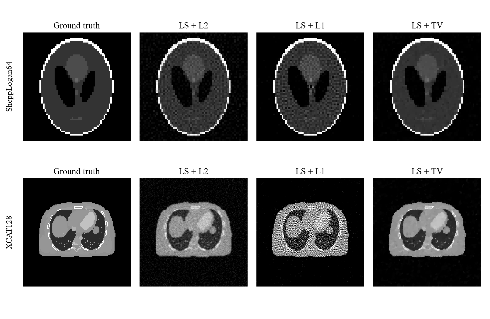
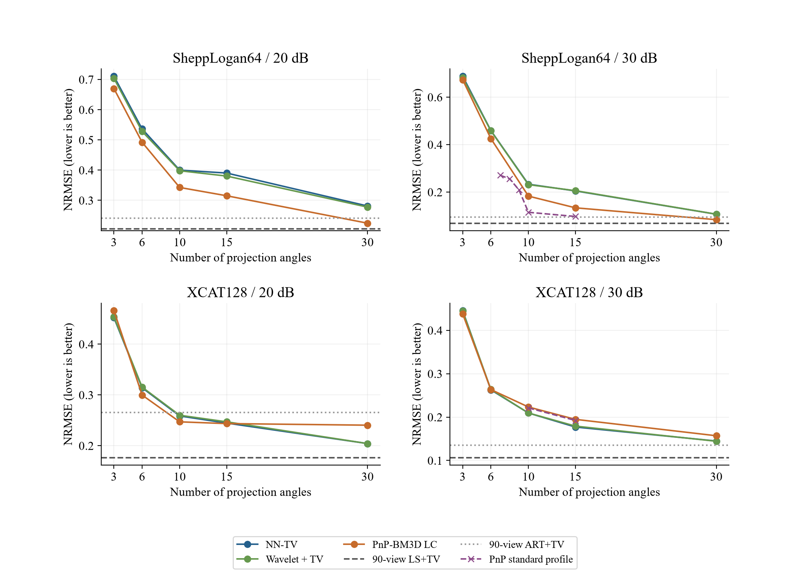
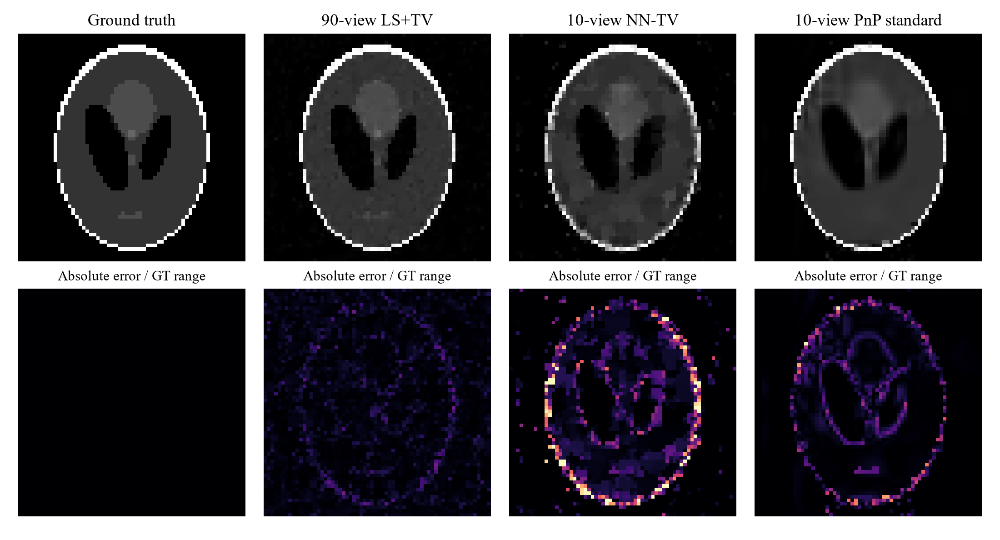

# CT图像重建与稀疏角度优化实验报告

课程 最优化理论与算法    实验 Project 1

姓名 __________________    学号 __________________

日期 2026年10月11日

本报告总结CT图像的基础重建、正则化与稀疏角度实验，比较各方法的像素误差和结构保持能力。

[项目代码仓库](https://github.com/epiloguered/ct-reconstruction-project1)

代码、环境配置、实验参数和完整结果均在该仓库中整理，正文聚焦方法、结果与结论。

## 目录

- [一 实验目的与数据](#一-实验目的与数据)
- [二 基础重建与正则化方法](#二-基础重建与正则化方法)
- [三 少角度扩展方法](#三-少角度扩展方法)
- [四 评价指标与实验协议](#四-评价指标与实验协议)
- [五 无正则化基线结果](#五-无正则化基线结果)
- [六 正则化实验结果](#六-正则化实验结果)
- [七 稀疏角度传统方法结果](#七-稀疏角度传统方法结果)
- [八 非负TV 小波与PnP重建改进](#八-非负tv-小波与pnp重建改进)
- [九 各方法最佳结果主表](#九-各方法最佳结果主表)
- [十 讨论与结论](#十-讨论与结论)
- [附录 其他扩展结果](#附录-其他扩展结果)
- [参考文献](#参考文献)

### 摘要

本实验研究带噪声线性投影模型下的CT图像重建。使用课程给定的SheppLogan64与XCAT128数据，在15、20、25、30 dB四档信噪比下完成最小二乘和ART基线，以及L2、L1、TV正则化；进一步减少投影角度，比较非负TV、TGV、小波＋TV、DIP及PnP-BM3D。结果表明，无正则化最小二乘容易出现图像误差放大；TV在LS与ART两个系列的全部八个数据条件中均取得最低NRMSE。PnP-BM3D改善了部分少角度重建，但10角高SSIM案例仍比原90角LS+TV具有更高像素误差。报告同时汇总每种方法的最佳固定终点结果，展示角度数、噪声水平与重建质量的关系。

关键词 CT重建；最小二乘；ART；总变差；稀疏角度；PnP-BM3D

## 一 实验目的与数据

- 基础任务：使用给定投影矩阵A与带噪声观测b，通过LS和ART恢复图像，并比较L2、L1、TV正则化的效果。

- 扩展任务：减少投影方向，研究欠定系统下的重建质量，并探索尽量保持质量的少角度方案。质量参照采用原90角LS+TV和ART+TV。

表1 实验数据维度

| 数据集 | 图像大小 | 原A维度 | 每方向射线 | 10角A维度 |
| --- | --- | --- | --- | --- |
| SheppLogan64 | 64×64 | 8190×4096 | 91 | 910×4096 |
| XCAT128 | 128×128 | 16290×16384 | 181 | 1810×16384 |

数据由课程提供。下文SL64为SheppLogan64的简写，GT表示真实图像。原90个方向为0、2、…、178度；图像按列优先F顺序展开为向量x。每条射线只经过部分像素，因此A中绝大多数元素为0。采用CSR稀疏矩阵只存储非零元素及其位置，能够节省内存，并加快迭代中的投影Ax与残差反投影Aᵀ(Ax−b)。

> b = A x_gt + ε；SNR = 20 log₁₀(‖A x_gt‖₂ / ‖ε‖₂)

15–30 dB为输入信噪比：相同信号下，SNR越高，相对噪声越小。四档观测均使用给定文件。

## 二 基础重建与正则化方法

### 2.1 最小二乘与LSQR

> x_LS ∈ arg min_x ½ ‖Ax − b‖₂²

最小二乘LS通过最小化投影误差求解图像；LSQR是求解大型稀疏最小二乘问题的数值算法，依据Paige与Saunders的工作[1]。本实验调用SciPy LSQR，atol=btol=10⁻⁵、迭代上限10000、条件数上限10⁸，采用零初始化。

### 2.2 代数重建技术ART

ART依次利用每条射线纠正图像，依据Gordon等的代数重建技术[2]。下式aᵢ为A的第i行，松弛参数ω=1；每行更新后将负像素截为0，零范数行跳过更新。实验记录40轮，主结果采用固定第5轮。

> x ← max{0, x + ω (bᵢ − aᵢx) aᵢᵀ / ‖aᵢ‖₂²}

### 2.3 L2 L1与TV正则化

> min_x ½ ‖Ax − b‖₂² + λ R(x)

> R_L2(x)=½‖x‖₂²；R_L1(x)=‖x‖₁；TV(x)=Σᵢⱼ √((Dₕx)ᵢⱼ²+(Dᵥx)ᵢⱼ²)

- L2惩罚较大的像素能量；LS+L2使用damp=√λ的LSQR。

- 像素L1鼓励像素值稀疏；LS+L1使用FISTA[4]与软阈值更新。

- TV惩罚相邻像素梯度，其理论依据为Rudin、Osher与Fatemi的总变差模型[3]。LS+TV使用FISTA[4]，TV近端采用Chambolle算法[16]。

- ART+L2／L1／TV在每轮ART投影后加入相应收缩或TV处理，并与原ART的固定5轮结果比较。

表2 原90角正则化方案的迭代设置

| 方案 | 迭代设置 | 图像约束 |
| --- | --- | --- |
| LS+L2 | LSQR最多5000次 | 无非负约束 |
| LS+L1 | FISTA 1200步 | 无非负约束 |
| LS+TV | FISTA 600步；TV近端最多80步 | 无非负约束 |
| ART+L2/L1/TV | 固定5轮；每轮后加入先验处理 | 非负约束 |

## 三 少角度扩展方法

### 3.1 稀疏角度采样

少角度实验同步抽取A和b的测量行，保持像素数不变。对K个方向，原方向编号取floor(90j/K)，j=0,…,K−1；每方向保留全部探测器。例如10角为0、18、…、162度。稀疏角度CT使用TV的思路参考Sidky等[7]。

- 传统扩展覆盖90、45、30、15角，以及15、20、25、30 dB全部四档SNR。

- DIP与后续改进选取20、30 dB；非负TV、小波和PnP主要测试30、15、10、6、3角，SL64／30 dB另补测7、8、9角。

### 3.2 非负TV TGV与小波先验

非负TV在TV重建中加入x≥0约束。二阶TGV参考Bredies等[11]，同时约束一阶变化与二阶变化；小波＋TV联合利用小波系数和图像梯度的稀疏性，小波阈值理论参考Donoho[12]。本实验采用db2小波，优化使用Condat型原始—对偶分裂[13]。

### 3.3 PnP与BM3D

Plug-and-Play（PnP）在迭代中交替执行投影拟合与图像去噪，参考Venkatakrishnan等[8]。本实验使用ADMM型更新，将BM3D作为去噪器；BM3D利用相似图像块的协同滤波，参考Dabov等[9]。实际库为bm3d 4.0.3[15]，比较LC配置与常规配置。

> xᵏ⁺¹ = arg min_x ½‖Bx−d‖₂² + ½ρ‖x−zᵏ+uᵏ‖₂²

> zᵏ⁺¹ = max{D_σ(xᵏ⁺¹+uᵏ),0}；uᵏ⁺¹ = uᵏ+xᵏ⁺¹−zᵏ⁺¹

变量按GT极差s归一化，B=A/√L、d=b/(s√L)，输出s·z；Dσ为BM3D。投影子问题用预条件CG近似求解。PnP以同条件12000步非负TV结果为起点，9组参数各运行40步选参，再续至160步。

### 3.4 深度图像先验DIP

DIP依据Ulyanov等[10]，将图像写为未训练网络的输出x=s·fθ(z)，针对单份投影优化网络参数。本实验采用四尺度卷积网络、Softplus非负输出、固定随机输入、Adam优化和2000步训练；种子为0、1、2。DIP+TV在拟合损失中加入TV项，完整结果见附录。

## 四 评价指标与实验协议

### 4.1 指标选择

采用NRMSE、PSNR和SSIM共同评价重建图像。平方误差和PSNR的意义参考Wang与Bovik[5]，SSIM参考Wang等[6]；实际指标实现参考scikit-image文档[14]。

表3 评价指标及方向

| 指标 | 评价内容 | 方向 |
| --- | --- | --- |
| NRMSE | 相对像素误差：误差L2范数除以GT的L2范数 | 越小越好 |
| PSNR | 由均方误差计算的峰值信噪比，单位dB | 越大越好 |
| SSIM | 比较图像局部亮度、对比度与结构相似性 | 越大越好 |

NRMSE采用GT范数归一化；PSNR的强度范围取GT最大值减最小值。SSIM采用scikit-image默认7×7均匀窗口。另记录相对投影残差‖Ax−b‖₂/‖b‖₂，用于观察投影拟合程度。所有方法使用相同的指标实现和未经显示裁剪的保存数组。

### 4.2 结果比较方式

- 正则化和传统扩展在给定网格中按GT NRMSE选参数，PSNR与SSIM来自同一组参数。

- DIP主结果为固定2000步、三个种子的均值与样本标准差；非负TV及小波主结果为12000步，PnP主结果为160步。

- 主表保留各方法实际的约束、初始化及迭代设置；PnP计算还包括非负TV起点。固定终点结果与根据GT另选保存终点的结果分别报告。

- 少角度质量分别对照原90角LS+TV和ART+TV。传统扩展的90角重跑只用于该阶段内部的角度趋势比较。

## 五 无正则化基线结果

表4 原90角无正则化基线结果

| 数据集 | SNR | 方法 | NRMSE↓ | PSNR↑ dB | SSIM↑ | 投影残差↓ |
| --- | --- | --- | --- | --- | --- | --- |
| SL64 | 15 | LSQR | 2.9676 | 2.68 | 0.1435 | 0.1253 |
| SL64 | 15 | ART 第5轮 | 0.4577 | 18.91 | 0.4969 | 0.1918 |
| SL64 | 20 | LSQR | 1.8268 | 6.89 | 0.2751 | 0.0698 |
| SL64 | 20 | ART 第5轮 | 0.3139 | 22.19 | 0.6232 | 0.1097 |
| SL64 | 25 | LSQR | 0.9847 | 12.26 | 0.3557 | 0.0402 |
| SL64 | 25 | ART 第5轮 | 0.1944 | 26.35 | 0.7399 | 0.0650 |
| SL64 | 30 | LSQR | 0.5926 | 16.67 | 0.4743 | 0.0225 |
| SL64 | 30 | ART 第5轮 | 0.1340 | 29.59 | 0.8323 | 0.0378 |
| XCAT128 | 15 | LSQR | 121.7020 | -31.43 | -1.12e-05 | 0.0677 |
| XCAT128 | 15 | ART 第5轮 | 0.6874 | 13.53 | 0.1881 | 0.2004 |
| XCAT128 | 20 | LSQR | 67.3207 | -26.29 | -7.94e-06 | 0.0376 |
| XCAT128 | 20 | ART 第5轮 | 0.4454 | 17.30 | 0.3109 | 0.1166 |
| XCAT128 | 25 | LSQR | 38.7801 | -21.49 | 0.0001 | 0.0221 |
| XCAT128 | 25 | ART 第5轮 | 0.2714 | 21.60 | 0.4711 | 0.0674 |
| XCAT128 | 30 | LSQR | 18.1019 | -14.88 | 0.0007 | 0.0124 |
| XCAT128 | 30 | ART 第5轮 | 0.1760 | 25.37 | 0.6221 | 0.0436 |

- ART固定第5轮在两个数据集、全部四档SNR下均比无正则化LSQR具有更低NRMSE。30 dB时，SL64的两者分别为0.1340与0.5926，XCAT128分别为0.1760与18.1019。

- 较低投影残差并不对应较低图像误差。XCAT128／15 dB的LSQR投影残差仅0.0677，但NRMSE达到121.7020、PSNR为−31.43 dB。

- SNR从15提高至30 dB时，两种基线的NRMSE整体下降、PSNR和SSIM整体上升，说明相对噪声减小后重建质量改善。

## 六 正则化实验结果

### 6.1 SheppLogan64结果

表5 SheppLogan64原90角基线与正则化结果

| SNR dB | 方法 | NRMSE↓ | PSNR↑ dB | SSIM↑ |
| --- | --- | --- | --- | --- |
| 15 | LSQR | 2.9676 | 2.68 | 0.1435 |
| 15 | LS+L2 | 0.4576 | 18.91 | 0.4852 |
| 15 | LS+L1 | 0.4462 | 19.13 | 0.6688 |
| 15 | LS+TV | 0.2786 | 23.23 | 0.6841 |
| 15 | ART 第5轮 | 0.4577 | 18.91 | 0.4969 |
| 15 | ART+L2 | 0.4506 | 19.05 | 0.5022 |
| 15 | ART+L1 | 0.4562 | 18.94 | 0.5300 |
| 15 | ART+TV | 0.3790 | 20.55 | 0.5413 |
| 20 | LSQR | 1.8268 | 6.89 | 0.2751 |
| 20 | LS+L2 | 0.3477 | 21.30 | 0.5718 |
| 20 | LS+L1 | 0.3232 | 21.93 | 0.7135 |
| 20 | LS+TV | 0.2056 | 25.86 | 0.7077 |
| 20 | ART 第5轮 | 0.3139 | 22.19 | 0.6232 |
| 20 | ART+L2 | 0.3133 | 22.21 | 0.6244 |
| 20 | ART+L1 | 0.3136 | 22.20 | 0.6334 |
| 20 | ART+TV | 0.2411 | 24.48 | 0.7123 |
| 25 | LSQR | 0.9847 | 12.26 | 0.3557 |
| 25 | LS+L2 | 0.2581 | 23.89 | 0.6433 |
| 25 | LS+L1 | 0.2179 | 25.36 | 0.8025 |
| 25 | LS+TV | 0.1045 | 31.74 | 0.9227 |
| 25 | ART 第5轮 | 0.1944 | 26.35 | 0.7399 |
| 25 | ART+L2 | 0.1944 | 26.35 | 0.7401 |
| 25 | ART+L1 | 0.1942 | 26.36 | 0.7530 |
| 25 | ART+TV | 0.1495 | 28.63 | 0.8044 |
| 30 | LSQR | 0.5926 | 16.67 | 0.4743 |
| 30 | LS+L2 | 0.1898 | 26.56 | 0.7033 |
| 30 | LS+L1 | 0.1457 | 28.85 | 0.8604 |
| 30 | LS+TV | 0.0688 | 35.37 | 0.9339 |
| 30 | ART 第5轮 | 0.1340 | 29.59 | 0.8323 |
| 30 | ART+L2 | 0.1341 | 29.57 | 0.8324 |
| 30 | ART+L1 | 0.1339 | 29.59 | 0.8372 |
| 30 | ART+TV | 0.0943 | 32.64 | 0.9088 |

- 四档SNR下，LS+TV与ART+TV分别取得各自算法系列最低NRMSE；30 dB时两者为0.0688与0.0943。

- 20 dB时LS+L1的SSIM为0.7135，略高于LS+TV的0.7077；TV仍具有更低像素误差。

### 6.2 XCAT128结果

表6 XCAT128原90角基线与正则化结果

| SNR dB | 方法 | NRMSE↓ | PSNR↑ dB | SSIM↑ |
| --- | --- | --- | --- | --- |
| 15 | LSQR | 121.7020 | -31.43 | -1.12e-05 |
| 15 | LS+L2 | 0.3638 | 19.06 | 0.2347 |
| 15 | LS+L1 | 0.8665 | 11.52 | 0.6819 |
| 15 | LS+TV | 0.2269 | 23.16 | 0.5219 |
| 15 | ART 第5轮 | 0.6874 | 13.53 | 0.1881 |
| 15 | ART+L2 | 0.5856 | 14.93 | 0.2147 |
| 15 | ART+L1 | 0.6848 | 13.57 | 0.2545 |
| 15 | ART+TV | 0.3795 | 18.69 | 0.2805 |
| 20 | LSQR | 67.3207 | -26.29 | -7.94e-06 |
| 20 | LS+L2 | 0.2949 | 20.88 | 0.3256 |
| 20 | LS+L1 | 0.6902 | 13.50 | 0.7053 |
| 20 | LS+TV | 0.1765 | 25.34 | 0.8231 |
| 20 | ART 第5轮 | 0.4454 | 17.30 | 0.3109 |
| 20 | ART+L2 | 0.4155 | 17.91 | 0.3268 |
| 20 | ART+L1 | 0.4447 | 17.32 | 0.3631 |
| 20 | ART+TV | 0.2652 | 21.81 | 0.3930 |
| 25 | LSQR | 38.7801 | -21.49 | 0.0001 |
| 25 | LS+L2 | 0.2338 | 22.90 | 0.4023 |
| 25 | LS+L1 | 0.5293 | 15.80 | 0.7209 |
| 25 | LS+TV | 0.1411 | 27.29 | 0.8295 |
| 25 | ART 第5轮 | 0.2714 | 21.60 | 0.4711 |
| 25 | ART+L2 | 0.2685 | 21.70 | 0.4762 |
| 25 | ART+L1 | 0.2714 | 21.61 | 0.4812 |
| 25 | ART+TV | 0.1871 | 24.84 | 0.5207 |
| 30 | LSQR | 18.1019 | -14.88 | 0.0007 |
| 30 | LS+L2 | 0.1957 | 24.45 | 0.4656 |
| 30 | LS+L1 | 0.4177 | 17.86 | 0.7543 |
| 30 | LS+TV | 0.1066 | 29.72 | 0.8237 |
| 30 | ART 第5轮 | 0.1760 | 25.37 | 0.6221 |
| 30 | ART+L2 | 0.1760 | 25.37 | 0.6222 |
| 30 | ART+L1 | 0.1759 | 25.37 | 0.6583 |
| 30 | ART+TV | 0.1355 | 27.64 | 0.6596 |

- TV同样在四档SNR下取得各自算法系列最低NRMSE；30 dB时LS+TV由原LSQR的18.1019降至0.1066。

- 15 dB时LS+L1的SSIM为0.6819，高于TV的0.5219，但其NRMSE为0.8665，高于TV的0.2269。

### 6.3 正则化作用分析

- L2明显抑制无正则化LS的大幅度误差，但图像仍有噪声。

- 像素L1与TV使用不同先验：前者约束像素值稀疏性，后者约束梯度稀疏性。给定图像中TV对平坦区域和边缘的恢复更好。

- 两个数据集、四档SNR共八个条件中，TV在LS与ART系列均取得最低NRMSE；SSIM的最佳方法随条件变化。

## 七 稀疏角度传统方法结果

表7 传统扩展LS+TV的NRMSE

| 数据集 | SNR dB | 90角重跑 | 45角 | 30角 | 15角 |
| --- | --- | --- | --- | --- | --- |
| SL64 | 15 | 0.2786 | 0.3867 | 0.4275 | 0.5247 |
| SL64 | 20 | 0.2056 | 0.2593 | 0.3181 | 0.4440 |
| SL64 | 25 | 0.1045 | 0.1579 | 0.2002 | 0.3656 |
| SL64 | 30 | 0.0688 | 0.1053 | 0.1381 | 0.2912 |
| XCAT128 | 15 | 0.2269 | 0.2476 | 0.2613 | 0.3089 |
| XCAT128 | 20 | 0.1765 | 0.1989 | 0.2125 | 0.2455 |
| XCAT128 | 25 | 0.1411 | 0.1665 | 0.1796 | 0.2082 |
| XCAT128 | 30 | 0.1066 | 0.1390 | 0.1478 | 0.1885 |

表8 30 dB传统稀疏角度TV方案的三指标

| 数据集 | 角度 | 方法 | NRMSE↓ | PSNR↑ dB | SSIM↑ |
| --- | --- | --- | --- | --- | --- |
| SL64 | 90 | LS+TV | 0.0688 | 35.37 | 0.9339 |
| SL64 | 90 | ART+TV | 0.0943 | 32.64 | 0.9088 |
| SL64 | 45 | LS+TV | 0.1053 | 31.67 | 0.8810 |
| SL64 | 45 | ART+TV | 0.1524 | 28.46 | 0.8703 |
| SL64 | 30 | LS+TV | 0.1381 | 29.32 | 0.9179 |
| SL64 | 30 | ART+TV | 0.2204 | 25.26 | 0.8317 |
| SL64 | 15 | LS+TV | 0.2912 | 22.84 | 0.7669 |
| SL64 | 15 | ART+TV | 0.3698 | 20.76 | 0.7106 |
| XCAT128 | 90 | LS+TV | 0.1066 | 29.72 | 0.8237 |
| XCAT128 | 90 | ART+TV | 0.1355 | 27.64 | 0.6596 |
| XCAT128 | 45 | LS+TV | 0.1390 | 27.42 | 0.8874 |
| XCAT128 | 45 | ART+TV | 0.1533 | 26.57 | 0.6802 |
| XCAT128 | 30 | LS+TV | 0.1478 | 26.88 | 0.8432 |
| XCAT128 | 30 | ART+TV | 0.1665 | 25.85 | 0.6948 |
| XCAT128 | 15 | LS+TV | 0.1885 | 24.77 | 0.7146 |
| XCAT128 | 15 | ART+TV | 0.2154 | 23.61 | 0.6703 |

- 本阶段覆盖全部四档SNR。90角行使用该阶段重跑结果，与45、30、15角形成同一协议下的对照。

- LS+TV的NRMSE在各SNR下均随90→45→30→15角减少而上升。30 dB时，SL64由0.0688升至0.2912，XCAT128由0.1066升至0.1885。

- SSIM不严格随角度减少而下降。例如XCAT128／30 dB的45角LS+TV SSIM为0.8874，高于90角的0.8237，但NRMSE仍更高。

## 八 非负TV 小波与PnP重建改进

本节比较非负TV与PnP-BM3D。非负TV和小波＋TV取12000步终点，PnP取160步终点；参数按GT NRMSE选择。小波及3／6角结果同时展示在质量曲线中。

表9 非负TV与PnP-BM3D LC固定终点对照

| 数据集 | SNR | 角度 | 方法 | NRMSE↓ | PSNR↑ dB | SSIM↑ |
| --- | --- | --- | --- | --- | --- | --- |
| SL64 | 20 | 30 | 非负TV | 0.2813 | 23.14 | 0.7020 |
| SL64 | 20 | 30 | PnP-LC | 0.2244 | 25.10 | 0.8770 |
| SL64 | 20 | 15 | 非负TV | 0.3904 | 20.30 | 0.7188 |
| SL64 | 20 | 15 | PnP-LC | 0.3152 | 22.15 | 0.8139 |
| SL64 | 20 | 10 | 非负TV | 0.3999 | 20.09 | 0.6285 |
| SL64 | 20 | 10 | PnP-LC | 0.3426 | 21.43 | 0.7514 |
| SL64 | 30 | 30 | 非负TV | 0.1065 | 31.58 | 0.9143 |
| SL64 | 30 | 30 | PnP-LC | 0.0836 | 33.68 | 0.9607 |
| SL64 | 30 | 15 | 非负TV | 0.2048 | 25.90 | 0.8540 |
| SL64 | 30 | 15 | PnP-LC | 0.1336 | 29.61 | 0.9380 |
| SL64 | 30 | 10 | 非负TV | 0.2330 | 24.78 | 0.8305 |
| SL64 | 30 | 10 | PnP-LC | 0.1829 | 26.88 | 0.9151 |
| XCAT128 | 20 | 30 | 非负TV | 0.2041 | 24.08 | 0.8054 |
| XCAT128 | 20 | 30 | PnP-LC | 0.2403 | 22.66 | 0.8367 |
| XCAT128 | 20 | 15 | 非负TV | 0.2445 | 22.51 | 0.7918 |
| XCAT128 | 20 | 15 | PnP-LC | 0.2435 | 22.55 | 0.8280 |
| XCAT128 | 20 | 10 | 非负TV | 0.2585 | 22.03 | 0.7580 |
| XCAT128 | 20 | 10 | PnP-LC | 0.2469 | 22.43 | 0.8127 |
| XCAT128 | 30 | 30 | 非负TV | 0.1448 | 27.06 | 0.8603 |
| XCAT128 | 30 | 30 | PnP-LC | 0.1569 | 26.36 | 0.9104 |
| XCAT128 | 30 | 15 | 非负TV | 0.1771 | 25.32 | 0.8638 |
| XCAT128 | 30 | 15 | PnP-LC | 0.1948 | 24.49 | 0.8707 |
| XCAT128 | 30 | 10 | 非负TV | 0.2094 | 23.86 | 0.8343 |
| XCAT128 | 30 | 10 | PnP-LC | 0.2232 | 23.30 | 0.8423 |

- SL64的六个表列条件下，PnP-LC均比非负TV具有更低NRMSE。30 dB／15角时，NRMSE由0.2048降至0.1336，SSIM由0.8540升至0.9380。

- XCAT128的结果取决于噪声与角度。30 dB／15角时，PnP-LC NRMSE为0.1948，高于非负TV的0.1771，但SSIM略高。

### 8.1 角度与质量的权衡

进一步在全部已保存候选和续迭代终点中，寻找同时满足“NRMSE不高于90角参照、SSIM不低于同一参照”的最少已测角度。该表额外使用GT选择终点，与表9固定终点的口径不同。

表10 同时达到原90角NRMSE和SSIM的最少已测角度

| 数据集 | SNR | 90角参照 | 最少角度 | 方案 | NRMSE | SSIM |
| --- | --- | --- | --- | --- | --- | --- |
| SL64 | 20 | LS+TV | 未达到 | — | — | — |
| SL64 | 20 | ART+TV | 30 | PnP-LC 160步 | 0.2244 | 0.8770 |
| SL64 | 30 | LS+TV | 未达到 | — | — | — |
| SL64 | 30 | ART+TV | 30 | PnP-LC 40步 | 0.0834 | 0.9601 |
| XCAT128 | 20 | LS+TV | 未达到 | — | — | — |
| XCAT128 | 20 | ART+TV | 10 | PnP-LC 40步 | 0.2440 | 0.8126 |
| XCAT128 | 30 | LS+TV | 未达到 | — | — | — |
| XCAT128 | 30 | ART+TV | 未达到 | — | — | — |

- 相对原90角ART+TV，SL64的20与30 dB可在30角达标，XCAT128／20 dB可在10角达标。

- 相对原90角LS+TV，四个20／30 dB条件均未在本次3–30角保存结果中同时达标。

### 8.2 高SSIM案例分析

表11 SL64的30 dB常规BM3D配置补测

| 方案 | NRMSE↓ | PSNR↑ dB | SSIM↑ |
| --- | --- | --- | --- |
| 90角 LS+TV | 0.0688 | 35.37 | 0.9339 |
| 90角 ART+TV | 0.0943 | 32.64 | 0.9088 |
| 10角 PnP常规160步 | 0.1147 | 30.94 | 0.9440 |

10角常规配置沿用LC选中的ρ=0.03、σ=0.03。保存结果NRMSE为0.114672、SSIM为0.944047。

表12 同一案例的区域诊断

| 方案 | 背景SSIM↑ | 前景SSIM↑ | 边缘RMSE↓ |
| --- | --- | --- | --- |
| 90角LS+TV | 0.9129 | 0.9548 | 0.0303 |
| 90角ART+TV | 0.8807 | 0.9367 | 0.0469 |
| 10角非负TV | 0.8617 | 0.7994 | 0.1260 |
| 10角常规PnP | 0.9696 | 0.9186 | 0.0624 |

- 10角PnP相比90角LS+TV，NRMSE高约66.7%，PSNR低约4.44 dB，SSIM略高。

- 零背景占图像58.84%。PnP背景SSIM更高，但前景SSIM更低，边缘RMSE约为90角LS+TV的2.06倍；高全图SSIM主要伴随背景改善，小结构和边缘仍有损失。

## 九 各方法最佳结果主表

每个数据集、每种方法取已测条件中的最低NRMSE，三指标同源，选中条件均为30 dB。基础固定90角，扩展少于90角；各方法角度覆盖不同。DIP取三种子均值，其余按规定终点。本表用于成果汇总，同条件比较见表9，最少角度达标见表10。

表13 基础与扩展各方法的最佳固定终点结果 SNR均为30 dB

| 部分 | 数据集 | 方法 | 角度 | NRMSE↓ | PSNR↑ dB | SSIM↑ |
| --- | --- | --- | --- | --- | --- | --- |
| 基础 | SL64 | LSQR | 90 | 0.5926 | 16.67 | 0.4743 |
| 基础 | SL64 | ART（固定5轮） | 90 | 0.1340 | 29.59 | 0.8323 |
| 基础 | SL64 | LS+L2 | 90 | 0.1898 | 26.56 | 0.7033 |
| 基础 | SL64 | LS+L1 | 90 | 0.1457 | 28.85 | 0.8604 |
| 基础 | SL64 | LS+TV | 90 | 0.0688 | 35.37 | 0.9339 |
| 基础 | SL64 | ART+L2 | 90 | 0.1341 | 29.57 | 0.8324 |
| 基础 | SL64 | ART+L1 | 90 | 0.1339 | 29.59 | 0.8372 |
| 基础 | SL64 | ART+TV | 90 | 0.0943 | 32.64 | 0.9088 |
| 基础 | XCAT128 | LSQR | 90 | 18.1019 | -14.88 | 0.0007 |
| 基础 | XCAT128 | ART（固定5轮） | 90 | 0.1760 | 25.37 | 0.6221 |
| 基础 | XCAT128 | LS+L2 | 90 | 0.1957 | 24.45 | 0.4656 |
| 基础 | XCAT128 | LS+L1 | 90 | 0.4177 | 17.86 | 0.7543 |
| 基础 | XCAT128 | LS+TV | 90 | 0.1066 | 29.72 | 0.8237 |
| 基础 | XCAT128 | ART+L2 | 90 | 0.1760 | 25.37 | 0.6222 |
| 基础 | XCAT128 | ART+L1 | 90 | 0.1759 | 25.37 | 0.6583 |
| 基础 | XCAT128 | ART+TV | 90 | 0.1355 | 27.64 | 0.6596 |
| 扩展 | SL64 | LSQR | 15 | 1.4381 | 8.97 | 0.2850 |
| 扩展 | SL64 | ART（固定5轮） | 45 | 0.1946 | 26.34 | 0.7904 |
| 扩展 | SL64 | LS+L2 | 45 | 0.3219 | 21.97 | 0.6187 |
| 扩展 | SL64 | LS+TV | 45 | 0.1053 | 31.67 | 0.8810 |
| 扩展 | SL64 | ART+TV | 45 | 0.1524 | 28.46 | 0.8703 |
| 扩展 | SL64 | DIP | 30 | 0.1815 | 26.96 | 0.8176 |
| 扩展 | SL64 | DIP+TV | 30 | 0.1029 | 31.88 | 0.9354 |
| 扩展 | SL64 | 非负TV | 30 | 0.1065 | 31.58 | 0.9143 |
| 扩展 | SL64 | TGV+非负 | 30 | 0.1065 | 31.58 | 0.9143 |
| 扩展 | SL64 | 小波+TV+非负 | 30 | 0.1068 | 31.55 | 0.9162 |
| 扩展 | SL64 | PnP-BM3D（LC配置） | 30 | 0.0836 | 33.68 | 0.9607 |
| 扩展 | SL64 | PnP-BM3D（常规配置） | 15 | 0.0971 | 32.38 | 0.9521 |
| 扩展 | XCAT128 | LSQR | 15 | 1.5625 | 6.40 | 0.1488 |
| 扩展 | XCAT128 | ART（固定5轮） | 45 | 0.1848 | 24.94 | 0.6844 |
| 扩展 | XCAT128 | LS+L2 | 45 | 0.2239 | 23.28 | 0.4365 |
| 扩展 | XCAT128 | LS+TV | 45 | 0.1390 | 27.42 | 0.8874 |
| 扩展 | XCAT128 | ART+TV | 45 | 0.1533 | 26.57 | 0.6802 |
| 扩展 | XCAT128 | DIP | 30 | 0.2539 | 22.19 | 0.8090 |
| 扩展 | XCAT128 | DIP+TV | 30 | 0.1594 | 26.23 | 0.8689 |
| 扩展 | XCAT128 | 非负TV | 30 | 0.1448 | 27.06 | 0.8603 |
| 扩展 | XCAT128 | TGV+非负 | 30 | 0.1448 | 27.06 | 0.8603 |
| 扩展 | XCAT128 | 小波+TV+非负 | 30 | 0.1443 | 27.10 | 0.8657 |
| 扩展 | XCAT128 | PnP-BM3D（LC配置） | 30 | 0.1569 | 26.36 | 0.9104 |
| 扩展 | XCAT128 | PnP-BM3D（常规配置） | 15 | 0.1923 | 24.60 | 0.8768 |

## 十 讨论与结论

### 10.1 基础实验

- 无正则化LS容易放大带噪声观测中的误差；采用非负约束、固定5轮的ART在八个条件下均比LSQR具有更低NRMSE。

- L2、L1和TV整体改善了LS重建，其中TV在八个数据条件中均取得LS与ART各系列最低NRMSE。

- PSNR、NRMSE与SSIM反映不同侧面。L1在部分条件有较高SSIM，但像素误差仍高于TV；投影残差低也不保证图像误差低。

### 10.2 扩展实验

- 减少投影方向会增加重建难度。传统LS+TV在四档SNR下均随角度减少出现NRMSE上升。

- 非负TV、小波＋TV与PnP-BM3D改善了部分少角度结果。PnP对SL64改善更明显，XCAT128部分条件仍由非负TV更好。

- 10角PnP可以达到较高SSIM，但本次结果仍弱于原90角LS+TV的像素精度；背景、前景和边缘诊断说明了这种指标差异。

- 正则化及多数扩展按GT NRMSE选参；本文结果对应所列迭代设置。4线程BM3D重跑观察到小幅数值变化，保存结果与核验记录均保留在仓库。

### 10.3 代码 参数与复现

[项目首页与运行入口](https://github.com/epiloguered/ct-reconstruction-project1)

[环境 算法参数与复现命令](https://github.com/epiloguered/ct-reconstruction-project1/blob/main/docs/实验实施记录.md)

[完整实验结果与历史记录](https://github.com/epiloguered/ct-reconstruction-project1/blob/main/docs/基线实验结果.md)

[主表与汇总CSV](https://github.com/epiloguered/ct-reconstruction-project1/tree/main/outputs/final)

## 附录 其他扩展结果

### A.1 DIP与DIP加TV

表A1 DIP固定2000步的三种子均值与样本标准差

| 数据集 | 角度 | SNR | 方案 | NRMSE↓ | PSNR↑ dB | SSIM↑ |
| --- | --- | --- | --- | --- | --- | --- |
| SL64 | 30 | 20 | DIP | 0.5808±0.0199 | 16.85±0.30 | 0.5484±0.0129 |
| SL64 | 30 | 20 | DIP+TV | 0.3077±0.0012 | 22.36±0.03 | 0.8163±0.0017 |
| SL64 | 30 | 30 | DIP | 0.1815±0.0116 | 26.96±0.57 | 0.8176±0.0126 |
| SL64 | 30 | 30 | DIP+TV | 0.1029±0.0007 | 31.88±0.06 | 0.9354±0.0014 |
| SL64 | 15 | 20 | DIP | 0.6087±0.1276 | 16.56±1.76 | 0.5595±0.0729 |
| SL64 | 15 | 20 | DIP+TV | 0.3905±0.0068 | 20.29±0.15 | 0.7495±0.0176 |
| SL64 | 15 | 30 | DIP | 0.4353±0.2595 | 20.28±4.77 | 0.6065±0.2514 |
| SL64 | 15 | 30 | DIP+TV | 0.1897±0.0017 | 26.56±0.08 | 0.8834±0.0058 |
| XCAT128 | 30 | 20 | DIP | 0.4601±0.2239 | 17.66±3.98 | 0.6211±0.1332 |
| XCAT128 | 30 | 20 | DIP+TV | 0.2369±0.0522 | 22.92±1.82 | 0.7486±0.0771 |
| XCAT128 | 30 | 30 | DIP | 0.2539±0.0146 | 22.19±0.49 | 0.8090±0.0051 |
| XCAT128 | 30 | 30 | DIP+TV | 0.1594±0.0043 | 26.23±0.23 | 0.8689±0.0052 |
| XCAT128 | 15 | 20 | DIP | 0.6341±0.1755 | 14.49±2.67 | 0.5191±0.0577 |
| XCAT128 | 15 | 20 | DIP+TV | 0.2604±0.0018 | 21.96±0.06 | 0.7266±0.0041 |
| XCAT128 | 15 | 30 | DIP | 0.3041±0.0021 | 20.62±0.06 | 0.7568±0.0024 |
| XCAT128 | 15 | 30 | DIP+TV | 0.1980±0.0049 | 24.35±0.21 | 0.8269±0.0046 |

- DIP与DIP+TV共48次拟合。DIP+TV在全部八个条件下的平均NRMSE均低于DIP；30角／30 dB的SL64结果由0.1815降至0.1029。

- 另完成24次留出投影DIP+TV拟合：8个条件中6个的验证截点平均NRMSE优于同次训练固定2000步，1个优于历史全投影训练结果。

### A.2 TGV与小波先验

- 同求解器、同单个候选迭代预算下，非负TV在8个条件均优于无约束TV；TGV在5个条件的NRMSE低于非负TV。TGV与TV搜索分别为27组与9组。

- 小波＋TV在主20个条件中的11个比非负TV具有更低固定终点NRMSE，PnP-LC为14个。

## 参考文献

[1] Christopher C. Paige; Michael A. Saunders. LSQR: An Algorithm for Sparse Linear Equations and Sparse Least Squares. ACM Transactions on Mathematical Software, 8(1):43–71, 1982. https://doi.org/10.1145/355984.355989

[2] Richard Gordon; Robert Bender; Gábor T. Herman. Algebraic reconstruction techniques (ART) for three-dimensional electron microscopy and x-ray photography. Journal of Theoretical Biology, 29(3):471–481, 1970. https://doi.org/10.1016/0022-5193(70)90109-8

[3] Leonid I. Rudin; Stanley Osher; Emad Fatemi. Nonlinear total variation based noise removal algorithms. Physica D: Nonlinear Phenomena, 60(1–4):259–268, 1992. https://doi.org/10.1016/0167-2789(92)90242-F

[4] Amir Beck; Marc Teboulle. A Fast Iterative Shrinkage-Thresholding Algorithm for Linear Inverse Problems. SIAM Journal on Imaging Sciences, 2(1):183–202, 2009. https://doi.org/10.1137/080716542

[5] Zhou Wang; Alan C. Bovik. Mean Squared Error: Love It or Leave It? A New Look at Signal Fidelity Measures. IEEE Signal Processing Magazine, 26(1):98–117, 2009. https://doi.org/10.1109/MSP.2008.930649

[6] Zhou Wang; Alan C. Bovik; Hamid R. Sheikh; Eero P. Simoncelli. Image Quality Assessment: From Error Visibility to Structural Similarity. IEEE Transactions on Image Processing, 13(4):600–612, 2004. https://doi.org/10.1109/TIP.2003.819861

[7] Emil Y. Sidky; Chien-Min Kao; Xiaochuan Pan. Accurate image reconstruction from few-views and limited-angle data in divergent-beam CT. Journal of X-Ray Science and Technology, 14(2):119–139, 2006. https://doi.org/10.3233/XST-2006-00155

[8] Singanallur V. Venkatakrishnan; Charles A. Bouman; Brendt Wohlberg. Plug-and-Play Priors for Model Based Reconstruction. 2013 IEEE Global Conference on Signal and Information Processing (GlobalSIP):945–948, 2013. https://doi.org/10.1109/GlobalSIP.2013.6737048

[9] Kostadin Dabov; Alessandro Foi; Vladimir Katkovnik; Karen Egiazarian. Image Denoising by Sparse 3-D Transform-Domain Collaborative Filtering. IEEE Transactions on Image Processing, 16(8):2080–2095, 2007. https://doi.org/10.1109/TIP.2007.901238

[10] Dmitry Ulyanov; Andrea Vedaldi; Victor Lempitsky. Deep Image Prior. Proceedings of the IEEE Conference on Computer Vision and Pattern Recognition (CVPR):9446–9454, 2018. https://openaccess.thecvf.com/content_cvpr_2018/html/Ulyanov_Deep_Image_Prior_CVPR_2018_paper.html

[11] Kristian Bredies; Karl Kunisch; Thomas Pock. Total Generalized Variation. SIAM Journal on Imaging Sciences, 3(3):492–526, 2010. https://doi.org/10.1137/090769521

[12] David L. Donoho. De-Noising by Soft-Thresholding. IEEE Transactions on Information Theory, 41(3):613–627, 1995. https://doi.org/10.1109/18.382009

[13] Laurent Condat. A Primal–Dual Splitting Method for Convex Optimization Involving Lipschitzian, Proximable and Linear Composite Terms. Journal of Optimization Theory and Applications, 158(2):460–479, 2013. https://doi.org/10.1007/s10957-012-0245-9

[14] scikit-image developers. skimage.metrics API documentation, version 0.26. Official software documentation. https://scikit-image.org/docs/0.26.x/api/skimage.metrics.html (accessed 2026-10-11)

[15] Ymir Mäkinen; Lucio Azzari; Alessandro Foi. bm3d 4.0.3: Python wrapper for BM3D denoising. Official PyPI package description. https://pypi.org/project/bm3d/4.0.3/ (accessed 2026-10-11)

[16] Antonin Chambolle. An Algorithm for Total Variation Minimization and Applications. Journal of Mathematical Imaging and Vision, 20:89–97, 2004. https://doi.org/10.1023/B:JMIV.0000011325.36760.1e
